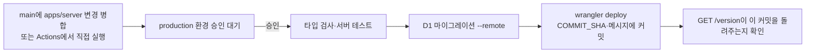

# 서버 배포

서버(`apps/server`, Cloudflare Workers + D1)는 **GitHub Actions의 `deploy-server` 워크플로로만** 배포한다. 로컬에서 `wrangler deploy`를
돌리면 운영이 어느 커밋으로 도는지 기록이 남지 않는다(2026-11-23에 병합 전 브랜치를 로컬에서 배포한 일이 있었다).

## 흐름

- **언제 도는가**: main에 `apps/server/**`, 루트의 `package.json`·`pnpm-lock.yaml`·`pnpm-workspace.yaml`(서버 의존성 보안 패치 등), 워크플로 자신이 바뀐 커밋이 들어올 때. Actions 화면의 **Run workflow**로 직접 돌릴 수도 있다 —
  "Use workflow from"에서 브랜치를 고르면 병합 전에 서버를 먼저 올릴 수 있고, 그 실행 기록에 브랜치와 커밋이 남는다.
- **승인**: 저장소의 `production` 환경에 필수 승인자를 둔다. 승인하기 전에는 아무것도 하지 않는다. 배포는 CI와 동시에 돌므로 **같은 커밋의 ci가
  녹색인지 보고 승인한다**(배포 작업도 서버 검사는 다시 돌린다).
- **뒤로 가지 않기**: 배포 전에 운영의 `/version`과 이 커밋의 `API_VERSION`을 견준다. 이 커밋이 더 낮으면 멈춘다 — 브랜치를 먼저 배포한 뒤
  main의 다른 서버 변경이 자동 배포되면 운영이 옛 계약으로 돌아가는 것을 막는다. 의도한 되돌리기는 직접 실행에서 `allow_downgrade`를 켠다.
  (스쿼시 병합이라 "운영 커밋이 이 커밋의 조상인가"로는 판단하지 않는다 — 병합 커밋은 브랜치 커밋을 조상으로 갖지 않는다.)
  운영의 `/version`을 읽지 못하면(5xx·네트워크) 멈춘다 — 통과로 보지 않는다. 이 확인과 서버 검사는 환경·토큰이 없는 `check` job이 **승인 전에** 한다.
  **한계**: API 번호가 같은 채로 코드만 뒤로 가는 경우(먼저 배포한 브랜치의 버그 수정을 main이 덮는 경우)는 잡지 못한다 — 브랜치를 먼저 배포했으면
  그 PR을 먼저 병합하고, 승인 화면에서 지금 운영 커밋(`/version`)과 견준다.
- **토큰의 범위**: Cloudflare API 토큰은 마이그레이션·배포 단계에만 준다. 의존성 설치(`--filter server...`)와 테스트 단계는 토큰을 읽을 수 없다.
- **기록**: 저장소의 Environments → `production`에 배포마다 커밋·실행·승인자가 남는다. Cloudflare 쪽에서도 Worker 버전 메시지에 커밋 앞 12자리가
  들어가 같은 커밋을 찾을 수 있다.
- **운영이 지금 어느 코드인가**: `GET /version` → `{"api": 2, "commit": "<배포한 커밋>"}`. 워크플로 밖에서 올린 버전은 `commit`이 `null`이다.

## 규칙

1. **마이그레이션은 추가만 한다.** 마이그레이션이 새 Worker보다 먼저 적용되므로, 그 사이(그리고 되돌렸을 때) 이전 Worker가 새 DB에서 돌아야 한다.
   칸·테이블 추가는 괜찮다. 칸 삭제·이름 바꾸기·의미 바꾸기는 두 번에 나눈다(먼저 새 칸을 쓰는 코드를 배포하고, 다음 배포에서 옛 칸을 정리한다).
   `scripts/tests/test_migrations.py`가 새 마이그레이션의 `DROP`·`RENAME`을 막는다(정말 필요하면 그 파일의 허용 목록에 이유와 함께 올린다).
   **원격에 한 번 적용한 마이그레이션 파일은 고치지 않는다.** D1은 파일 이름으로 적용 여부를 기록해서, 고친 내용은 다시 돌지 않고 운영 DB와 저장소의
   스키마가 조용히 어긋난다. 고칠 것이 있으면 새 파일을 추가한다 — 브랜치를 먼저 배포한 뒤 리뷰에서 마이그레이션을 고치게 됐을 때도 같다.
2. **서버를 먼저, 앱은 그다음.** 앱이 서버의 새 칸·새 주소에 기대게 되면 서버의 `API_VERSION`(`apps/server/src/version.ts`)과 앱의
   `REQUIRED_SERVER_API`(`packages/cloud/src/cloud/compat.py`)를 함께 올린다(같은 값인지 테스트가 본다). 앱 출시 워크플로(`release`)는 운영 서버의
   `/version`이 그 값 이상인지 먼저 확인하고, 아니면 태그 출시를 멈춘다(`scripts/check_server_api.py`).
3. **이전 앱과의 호환.** 새 서버는 이전 버전 앱의 요청도 받아야 한다(사용자가 앱을 바로 올리지 않는다). 예: 기간 칸이 없는 목표 수정은 서버의 기간을
   그대로 둔다(`docs/goal-management.md`의 C).
4. **로컬에서 운영에 배포하지 않는다.** 급할 때도 워크플로를 직접 실행한다. 로컬 `wrangler`는 `--local`(개발 DB)과 `wrangler dev`에만 쓴다.
   그래서 `apps/server/package.json`에는 `deploy` 스크립트를 두지 않는다.

## 되돌리기

- **코드**: Cloudflare 대시보드의 Worker → Deployments에서 이전 버전으로 되돌리거나 `wrangler rollback`(그 뒤 고친 커밋을 워크플로로 다시 배포한다).
  규칙 1을 지켰다면 이전 Worker는 새 DB에서 그대로 돈다.
- **DB**: 마이그레이션은 되돌리지 않는다(앞으로만 간다). 데이터가 잘못됐을 때는 D1 Time Travel로 특정 시점으로 복원할 수 있다(최근 30일,
  `wrangler d1 time-travel restore`). 복원은 그 시점 이후의 모든 쓰기를 잃으므로 마지막 수단이다.

## 처음 설정(저장소 관리자가 한 번)

1. **Cloudflare API 토큰 만들기** — Cloudflare 대시보드 → My Profile → API Tokens → Create Token → "Edit Cloudflare Workers" 템플릿에서:
   - 권한: `Account / Workers Scripts / Edit`, `Account / D1 / Edit`(템플릿에 없으면 추가). 그 밖의 권한(Zone, DNS 등)은 뺀다.
   - Account Resources: 이 서버의 계정 하나만. 만료일을 정해 두고 바꾼다.
2. **GitHub에 넣기** — 저장소 Settings → Environments → **New environment** `production`:
   - Required reviewers: 배포를 승인할 사람.
   - Deployment branches: 지금(혼자 쓰는 저장소)은 "No restriction" — 병합 전 브랜치를 직접 실행으로 올릴 수 있게, 승인이 문을 지킨다.
     **협업자가 생기면 반드시 좁힌다**: 직접 실행은 고른 브랜치의 워크플로 파일을 그대로 쓰므로, 쓰기 권한이 있는 사람이 브랜치에서 yml을 고쳐
     토큰을 밖으로 보내는 단계를 넣을 수 있고 승인자는 바뀐 yml을 보지 못한다. 그때는 배포 가능 브랜치를 `main`과 보호된 패턴(예: `deploy/*`)으로
     제한하고, "Prevent self-review"를 켠다(혼자일 때 켜면 아무도 승인할 수 없다).
   - Environment secrets: `CLOUDFLARE_API_TOKEN`(위 토큰), `CLOUDFLARE_ACCOUNT_ID`(대시보드 오른쪽의 Account ID).
   비밀은 저장소 전체가 아니라 **환경 비밀**로 넣는다 — 승인된 배포 작업만 읽을 수 있다.
3. **운영 비밀은 그대로 Cloudflare에** — `GOOGLE_CLIENT_SECRET`, `RESEND_API_KEY`는 지금처럼 `wrangler secret put`으로 Cloudflare에만 둔다. GitHub로 옮기지 않는다.
4. 첫 실행: Actions → deploy-server → Run workflow(main). 승인 → 끝나면 `/version`의 `commit`이 main의 커밋과 같은지 본다.
