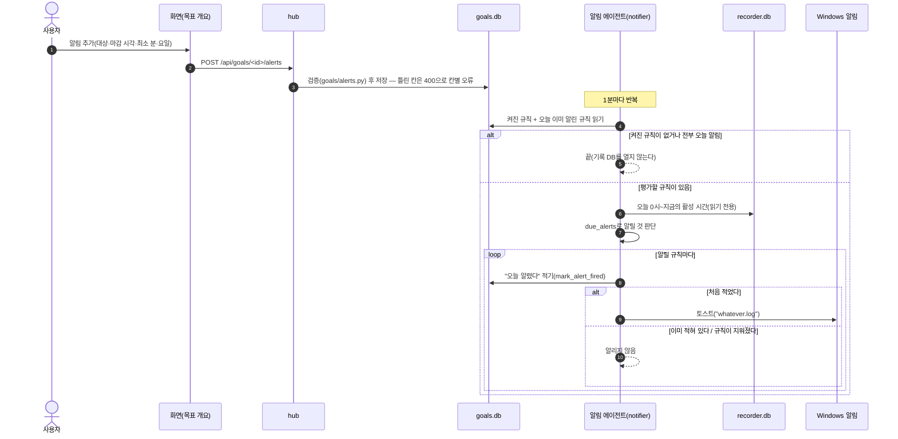
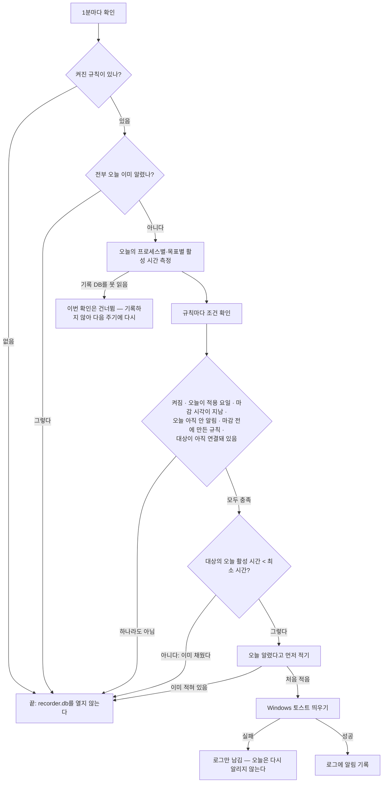

# 목표 프로세스 관리 기능 (현황 · 알림 · 보고서)

목표(`docs/goals-design.md`)에 프로세스·사이트를 연결해 두면 "하루에 몇 분 했는가"는 홈에서 볼 수 있다. 이 문서는 그 위에 얹은 **목표 관리 기능**을 세 덩어리로 나눠 정리한다. 1(현황)과 2(알림)는 끝까지 만들었고, 3(보고서 메일)은
**일정 설정까지** 만들었다 — 실제 메일 발송 연결만 다음 작업이다.

| # | 기능 | 상태 |
| --- | --- | --- |
| 1 | 목표에 연결한 프로세스의 **일·주·월 현황 확인** | 완료 — 목표 개요 화면 |
| 2 | 정해진 시각까지 수행하지 않았을 때 **시스템 알림** | 완료 — 규칙 설정 화면 + 알림 에이전트(`apps/notifier`) |
| 3 | 목표 **보고서 메일링 일정** 설정 | 일정 설정·저장까지 완료, **메일 발송 연결은 다음 PR** |

이어서 만들 것(홈 캐러셀, 목표 기간, 메일 구독)과 정한 방향은 바로 아래 "다음 개발 방향"에 있다.

## 다음 개발 방향 (결정 기록)

아래는 이어서 만들 세 가지(홈 캐러셀, 목표 기간, 메일 구독)에 대해 **정한 방향**이다. 각 항목의 근거와 검토 내용은 코드 리뷰 때 나온 질문(Q1~Q8)에 답한 것이고, 구현하면서 이 문서가 기준이 된다. 바뀌면 코드보다 이 문서를 먼저 고친다.

### 진행 순서 (PR 단위)

| 순서 | 내용 | 상태 |
| --- | --- | --- |
| **A** | 홈 목표 캐러셀(수동 전환) | **구현** |
| **B** | 목표 기간(없음/설정): 로컬 DB(스키마 5), 검증, 달성률 정의, 달력 일반화, 폼 | 예정 |
| **C** | 기간의 서버 동기화(마이그레이션, 계약, 확인 창, 데이터 취급 문서) | 예정 |
| **D** | 메일 구독의 서버 부분: 구독 테이블(UNIQUE), 상태, 가드, 확인 메일, 한도, 수신 거부 | 예정 |
| **E** | Cron 발송, 보고서 본문, 시간대, 중복·누락 방지, hub 중개와 화면 연결 | 예정 |

한 PR로 묶지 않는다: A는 UI뿐이고, B·C는 목표 데이터의 모양이 바뀌고, D·E는 서버에 상태와 스케줄러가 생긴다.

### A. 홈 목표 캐러셀 (구현됨)

- 홈 맨 위의 드롭다운 선택기를 **캐러셀**로 바꿨다: `← 공부  목표 전체  운동 →`(화살표 안쪽에 이웃 이름이 연하게 엿보인다). 순서는 **목표 전체 → 목표 1 → … → 목표 N → (다시) 목표 전체**의 원형이다.
- **자동으로 넘어가지 않는다.** 좌우 화살표와 키보드(← →)로만 옮긴다. 자동 전환은 읽는 중에 화면이 바뀌고, 일시정지·`prefers-reduced-motion` 같은 접근성 규칙이 따라오기 때문에 쓰지 않는다(필요해지면 그때 정지 컨트롤과 함께 다시 정한다).
- **배치**: 맨 위 한 줄에 왼쪽은 캐러셀, 오른쪽은 날짜 이동(← 라벨 →)이 **같은 높이**로 놓인다(캐러셀은 18rem, 좁은 창에서는 줄바꿈). **일/주/월은 줄에 따로 두지 않고** 날짜 라벨을 누르면 열리는 팝업 맨 위에 있다(그 아래에 그 단위의 달력·목록). 단위를 바꾸면 팝업이 새 라벨 아래에 다시 열리고 포커스는 방금 누른 단위 단추에 남는다. 이 구조는 목표 개요·프로세스 상세 화면에도 같다. "2 / 4" 같은 위치 글자와 점 단추는 없다(스크린 리더에는 목표 링크의 이름으로 위치를 알린다).
- **모양**: 좌우 화살표는 줄 높이를 채우고 테두리가 없으며 올리면 회색으로 떠올라 단추임을 보인다. **이웃 힌트**: **화살표가 가장 바깥**, 그 안쪽(가운데 칸 쪽)에 왼쪽은 앞 칸 이름의 **앞 두 글자**, 오른쪽은 다음 칸 이름의 **앞 두 글자**(양쪽 모두 앞 두 글자)가 연하게 보인다(양쪽 모두 가운데 이름과 같은 크기·두께, 두 글자 너비로 고정; 화살표와는 간격을 둔다. 화살표와 힌트는 천천히 진해졌다 옅어지는 애니메이션이 있고, 마우스를 올리거나 포커스가 있으면 멈추며, 움직임 줄이기 설정이면 움직이지 않는다)(원형이라 목표 전체의 앞은 마지막 목표, 마지막 목표의 뒤는 `목표 전체`). 힌트는 화살표 단추의 일부라 눌러도 그쪽으로 가고, 단추 이름(`이전 목표: 이름`)에는 전체 이름이 있다. 목표가 하나도 없으면 힌트는 비운다. **가운데 칸**은 목표 하나를 보는 중이면 링크(손 모양 커서, 올리면 회색)로 **그 목표의 개요 화면(`#/goal/<id>`)** 으로 가고, 목표 전체는 갈 곳이 없어 평범한 커서의 글자다.
- **공통 컴포넌트 `TripleNav`** (`components/common/TripleNav.ts`): `[← (이웃 글자)] 가운데 [(이웃 글자) →]` 한 줄 — 단추 둘과 **자유롭게 채우는 가운데 칸**으로 이뤄진다. 모양 선택은 `bordered`(테두리 여부)이고, 주의를 끌어야 하는 곳에서만 켜는 `pulse`(천천히 진해졌다 옅어지는 애니메이션)가 있다. 목표 캐러셀(테두리 없음, 이웃 목표 이름의 앞 두 글자, pulse)과 날짜 이동(`Stepper`, 테두리 있음, 이웃 글자 없음)이 같은 컴포넌트를 쓴다. `update`로 단추 안을 그 자리에서 바꿔 포커스가 유지된다.
- **목표 전체**를 보면 오른쪽 차트는 지금까지처럼 구간의 모든 프로세스다.
- **목표 하나**를 고르면 그 목표에 **연결한 프로세스·사이트만** 보인다(활성 시간순, 기록 없는 연결 대상은 0). 사이트는 목표를 넘길 때마다 요청하지 않으려고 진행 응답의 **활성 시간만** 쓴다(목표 개요 화면은 브라우저별 요청으로 유휴 시간까지 보인다).
- **빈 상태가 다음 단계로 이어진다.**
  - 목표가 하나도 없으면: 요약 위에 "아직 목표가 없어요" 안내와 **목표 만들기** 버튼(목표 만들기 폼이 바로 열린다).
  - 고른 목표에 연결한 프로세스가 없으면: "등록된 프로세스가 없습니다. 새로 등록해 보세요."와 **프로세스 추가** 버튼(그 목표의 연결 관리 화면이 열린다).
  - 목표 진행을 불러오지 못한 채 목표를 골랐다면(일시적 실패): 다른 프로세스를 대신 보이지 않고 안내만 한다.
- 구조: 순서·이동 규칙은 `lib/goalCarousel.ts`(순수 로직, 시험), 그리기는 `components/goals/GoalCarousel.ts`, 차트 범위는 `components/usage/ScopedUsageChart.ts`. 캐러셀은 15초마다 다시 그려지는 내용 바깥에 한 번만 붙여 포커스가 갱신에 지워지지 않는다.

### B. 목표 기간 (없음 / 설정) — 예정

- 목표에 **기간**을 둔다: 기본은 **없음**(무기한, 지금의 모든 목표). **설정**을 고르면 **시작일·종료일**을 각각 달력으로 정한다(홈의 날짜 달력 컴포넌트를 일반화: 미래 선택 가능, 시작 ≤ 종료, "기간 없음"으로 되돌리기).
- **시작일은 오늘 이후**로만 정하고 고칠 수 있다 — 이미 지난 날은 확정이라는 원칙(스냅샷)을 지킨다. 종료일은 시작일 이후.
- **기간 밖의 날**은 목표량(분모)뿐 아니라 **달성 시간(분자)에서도 뺀다.** 분모만 빼면 종료일 이후의 활동이 달성률을 계속 올린다. 서버로 올라가는 날짜별 달성 계산(`goalsync.daily`)도 같은 규칙으로 맞춘다.
- **종료된 목표**: 관리 모달에서 "종료됨"으로 표시하고 지난 기록은 개요 화면에서 볼 수 있다. 홈 캐러셀에는 진행 중인 목표만 둔다. 알림 규칙은 종료 뒤에는 평가하지 않는다. 목표 20개 상한에는 포함한다.
- 입력은 `packages/goals`가 엄격하게 검증한다(`YYYY-MM-DD`, 시작 ≤ 종료). `goals.db` 스키마 5(기간 칸 추가, 기존 목표는 무기한).

### C. 기간의 서버 동기화 — 예정

- 메일이 종료를 판단해야 하므로 기간은 **서버에도 저장**한다: 서버 `goals`에 시작·종료일 칸, API 본문 파싱, 충돌(`revision`) 규칙, 동기화 확인 창의 비교 칸. 서버로 가는 값이 늘어나므로 `docs/data-handling.md`의 표와 칸 구성 테스트를 함께 바꾼다.

### D·E. 메일 구독 — 예정

**일정의 소유자가 PC에서 서버로 옮겨 간다.** 지금 보고서 일정은 이 PC의 `goals.db`에만 있지만, 메일은 서버가 보내므로 일정과 구독 상태를 서버가 갖는다.

- **로그인과 동기화가 전제**다. 로그인하지 않았거나 동기화하지 않는 목표는 메일을 설정할 수 없고, 화면이 이유를 알린다. 일정은 서버에 있는 목표(`remote_id`)에 붙는다. hub가 서버를 중개한다(`cloud` 어댑터 한 파일 원칙).
- 지금의 로컬 `goal_report_schedules`는 폐기한다(이미 저장된 설정은 서버로 옮기는 것을 D에서 정한다).
- **주기는 셋으로 한정한다**: 매일 / 매주(요일 선택) / 매월(일자 선택, 1~28일). 시각과 **시간대(IANA)**를 함께 저장한다.
- **개인당 한 목표에만 보낼 수 있다.** 진실은 **DB 제약**이다: 구독 테이블의 `user_id`에 `UNIQUE`를 두고 `INSERT … ON CONFLICT`로 처리한다. 가드(`withSubscriptionGuard` 같은 고차 함수 래퍼 — 이 서버는 `ROUTES` 배열의 함수형 핸들러라 클래스 데코레이터보다 래퍼가 맞는다)는 가독성을 위한 것이고, 확인 후 저장만 하면 동시에 두 요청이 올 때 둘 다 통과하므로 보장은 DB가 한다.
  이미 구독 중인 사용자가 다른 목표에 신청하면 막지 않고 "기존 구독을 이 목표로 옮길까요?"를 확인한다.
- **구독 상태**: `active`(발송 중) / `paused`(사용자가 끔) / `ended`(목표 종료·삭제·동기화 해제로 끝남, 자동). 목표를 지우거나 동기화를 해제하면 구독은 자동으로 끝나고 알린다.
- **첫 신청 확인 메일**: 안내형이다(이중 확인 링크 없음 — 이메일은 Google로 이미 검증됐다). "첫 신청"은 **사용자 단위의 `welcomed_at`**으로 정의하고 영구로 둔다(신청·해지를 반복해 메일 폭탄·한도 소진을 만들지 못하게).
  구독 저장 뒤 확인 메일이 실패하면 구독은 유지하고 `welcomed_at`을 비워 다음 기회에 다시 보낸다. 응답을 확인하지 못한 실패는 이미 접수됐을 수 있으므로 구독 ID로 만든 **결정적 멱등 키**를 쓴다. 확인 메일도 발송 한도에 들어간다(`mail_sends.kind`에 `welcome` 추가).
- **보고서 구간**: 매일 = **전날 하루**, 매주 = **지난 월~일**, 매월 = **지난달**. 달성도는 PC의 동기화 에이전트가 올린 값이라, 메일에 **"마지막 동기화 시각 기준"**을 적는다(PC가 꺼져 있었다면 낡을 수 있다). 목표 기간이 끝나면 마지막 보고서를 한 번 보내고 구독을 끝낸다.
- **스케줄러**: Cloudflare Cron(UTC)이 "N분마다 도는 하나"로 돌며 그 안에서 지금 보낼 구독을 고른다(무료 플랜의 Cron 개수 제한을 피한다). (구독, 구간 키)에 유니크 제약을 두어 중복을 막고, 마지막 발송 구간 기준으로 누락을 따라잡는다.
- **매일 주기와 비용**: 무료 한도(Resend 하루 100통, 서버 전체 상한 80통) 때문에 **매일 구독자가 상한을 넘으면 매일 발송은 열 수 없다.** 사람이 많아지면 유료로 전환하는 것을 전제로, 지금은 **플랜 칸(`free`)과 "매일 구독자 상한" 게이트**만 설계에 넣고 결제는 범위 밖이다. 상한에 닿으면 매주·매월만 신청할 수 있다고 알린다.
- **수신 거부는 이 범위에 넣는다**: 서명 토큰 링크와 `List-Unsubscribe` 헤더, 반송·신고 시 발송 정지 목록(스팸 신고는 새 도메인의 평판을 바로 깎는다). 계정을 삭제해도 한도가 초기화되지 않게 하는 원칙(`docs/mail-design.md`의 사용자 키)을 구독에도 같게 적용한다.
- 서버로 가는 값이 늘어난다(일정: 주기·시각·시간대): `docs/data-handling.md`에 추가한다.

## 1. 목표 현황 확인 (일 · 주 · 월)

### 사용자 흐름

1. 홈 → "목표 프로세스 관리" → 목록에서 목표를 누른다.
2. 모달이 닫히고 그 목표의 **개요 화면**(`#/goal/<id>`)으로 간다. 맨 위에 목표 이름과 "하루 2시간 · 매일 · 프로세스 2개 · 사이트 3개".
3. 그 아래는 **홈과 같은 구조**다: 일 / 주 / 월 선택과 구간 이동, 왼쪽에 이 목표의 요약(목표 수행 시간 `전체 | 현 기기`, 달성률, 연결한 프로세스·사이트별 시간), 오른쪽에 막대 차트.
   요약 맨 아래 링크는 홈의 "목표 프로세스 관리" 대신 **"프로세스 연결 관리"** 이고, 누르면 모달의 연결 관리 화면을 바로 연다.
4. 차트는 연결한 **프로세스와 사이트**를 한 줄로 놓는다(활성 시간순). 홈은 브라우저(chrome·edge)가 한 칸이지만, 목표 개요에서는 **브라우저 안의 연결한 사이트마다 한 칸**이다.
   사이트 칸에는 사이트 아이콘에 그 사이트를 연 브라우저 아이콘이 작게 겹쳐 붙는다. 그래서 지정한 실제 사이트끼리(예: claude.ai와 kepco.co.kr) 길이로 비교된다.
   기록이 없는 연결 대상도 0으로 함께 보인다 — "연결은 했는데 오늘은 안 열었다"가 보이는 것이 이 화면의 쓸모다.
5. 칸을 누르면 프로세스 상세로 간다(사이트 칸은 그 브라우저의 상세 — 거기에 사이트별 시간이 더 있다).

### 데이터: 새로 만든 질의 없이 기존 것을 쓴다

| 화면에 필요한 것 | 쓰는 질의 |
| --- | --- |
| 목표(이름·목표량·요일·연결 목록) | `GET /api/goals` |
| 구간의 프로세스별 활성·유휴·백그라운드·전체 시간 | `GET /api/usage` — 응답에서 **연결한 프로세스만 골라** 쓴다 |
| 브라우저 안 사이트별 시간 | `GET /api/sites` — 연결한 브라우저마다 한 번, 응답에서 **연결한 도메인만 골라** 쓴다 |
| 요약(수행 시간·달성률) | `GET /api/goals/progress`, `GET /api/goals/all-devices` — 홈과 같다 |

"목표에 연결된 것만 고른다"는 목록에서 이름을 거르는 화면 쪽 정리일 뿐이라 집계 규칙(수행 시간의 정의)은 서버(`packages/goals`·`packages/aggregation`)가 그대로 갖는다.
홈과 같은 컴포넌트(`PeriodView` · `UsageSummary` · 차트 칸 `ProcessColumn`)를 다시 쓴다. 주·월에서도 같은 질의가 구간만 바꿔 동작하므로 일 · 주 · 월 현황이 한 화면으로 해결된다.
나중에 구간별 목표 달성 추이(날짜별 막대 등)가 필요해지면 그때 hub에 목표 단위 질의를 더한다 — 지금은 필요 없다.

### 규칙

- 목표 개요는 **읽기 전용 화면**이다. 연결을 바꾸는 일은 기존 모달이 맡는다(규칙을 두 곳에 두지 않는다).
- 지워진 목표의 주소로 들어오면(북마크·새로고침) 오류가 아니라 "목표를 찾을 수 없어요"와 홈으로 가는 길을 보여 준다.
- 사이트 시간은 창 제목으로 추정한 값이고 foreground일 때만 알 수 있어 백그라운드 구간이 없다. 어떤 브라우저의 사이트 정보를 받지 못하면 그 사이트는 0으로 그리지 않고("안 썼다"로 읽힌다) 안내 문구로 알린다.

## 2. 시스템 알림

예: "출석 체크가 필요한 게임을 23시까지 켜지 않았다면 알려 줘."

### 규칙

**"마감 시각(HH:MM)까지 대상의 오늘 활성 시간이 N분 이상이 되지 않으면 알린다."**

- **대상**은 목표 전체(연결한 프로세스·사이트의 활성 시간 합 = 목표 수행 시간)이거나, 그 목표에 **연결한 프로세스 하나**다. 연결하지 않은 프로세스는 대상이 될 수 없다(수행 시간이 영원히 0이라 매일 알림이 뜨는 규칙이 되기 때문). 목표에서 그 프로세스의 연결을 뺐다면 그 규칙은 건너뛴다.
- 적용 요일을 정하고, **같은 규칙은 하루에 한 번만** 알린다(`goal_alert_log`). 규칙의 마감 시각이나 조건을 고치면 오늘 다시 평가받고, 켜짐 여부만 바꾸면 기록은 그대로다.
- 규칙을 **마감 시각이 지난 뒤에 만들었다면 그날은 건너뛴다**(만들자마자 알림이 뜨는 일을 막는다).
- 목표당 10개까지. 입력은 `goals/alerts.py`가 엄격하게 검증하고(시각은 `HH:MM`, 시간은 1~1440분 정수 …) 틀린 칸은 칸별 오류로 돌려준다.
- 이름 비교는 대소문자를 구분하지 않는다(`process_key`) — 목표 수행 시간 계산과 같다.

### 구조

- **규칙의 원본**은 `packages/goals`(`alerts.py`: 값 객체·검증·`due_alerts` 판단, `store.py`: 저장). 판단 함수는 기록 DB도 시계도 모르고 값을 받아 계산만 한다.
- **판단하고 알리는 쪽**은 별도 백그라운드 프로세스 `apps/notifier`(supervisor가 죽으면 다시 띄움, 로그인 때 자동 시작 — 기록기·동기화 에이전트와 같은 방식)다. 창이 닫혀 있어도 알림이 가야 하기 때문이다. 1분마다 `goals.db`의 켜진 규칙을 읽고,
  **규칙이 있을 때만** `recorder.db`를 읽기 전용으로 열어 오늘(이 PC의 자정부터 지금까지)의 활성 시간을 잰다.
- **알림**은 Windows 토스트다. 추가 패키지 없이 PowerShell의 WinRT 호출로 띄우고, 글자는 명령줄이 아니라 환경 변수로 넘긴다(목표 이름의 따옴표 등이 코드로 해석되지 않게). 알림에 앱 이름이 `whatever.log`로 보이도록 처음 띄울 때 현재 사용자(HKCU)에 앱 식별자 하나를 등록한다.
  `uv run python -m notifier --test`가 시험 알림을 띄운다.
- **한 번만** 알리기 위해 알림을 띄우기 **전에** "오늘 알렸다"를 적는다. 알림이 실패하면 그날은 다시 알리지 않는다(반복되는 알림보다 하나를 놓치는 쪽이 덜 해롭다).
- 알림을 눌렀을 때 앱을 여는 동작은 아직 없다(토스트가 앱 프로토콜을 요구한다). 필요해지면 그때 더한다.
- **개인정보:** 판단과 알림은 전부 이 PC 안에서 끝난다. 서버를 부르지 않고 `cloud`를 import하지 않으며(격리 테스트 대상), 로그인하지 않아도 동작한다. 프로세스·목표 이름은 PC 밖으로 나가지 않는다(`docs/data-handling.md`).

### 알림이 나가기까지의 흐름

규칙을 만드는 쪽(화면 → hub → `goals.db`)과 알리는 쪽(알림 에이전트)은 **`goals.db` 하나로만 만난다.** 에이전트는 hub·창과 통신하지 않으므로 창이 닫혀 있어도 알림이 간다.

**알림 에이전트가 한 번 확인할 때(`notifier.check_once`)**

**알림 한 건의 내용:** 제목은 `whatever.log`, 본문은 `'<목표 이름>'` 또는 `<프로세스 이름>`에 이어 "오늘 23:00까지 30분을 채우지 못했어요 (지금 10분)."처럼 마감 시각·최소 시간·지금까지의 시간을 적는다.
이 글은 이 PC 안에서 만들어져 Windows 알림으로만 가고 서버나 로그의 다른 곳으로 나가지 않는다(로그에는 규칙 번호만 남긴다).

**자주 묻는 경우**

| 상황 | 알림 |
| --- | --- |
| 마감 전에 이미 N분을 채웠다 | 없음 |
| 마감 시각이 지났는데 못 채웠다 | 마감 시각 이후 첫 확인(최대 1분 뒤)에 **한 번** |
| 알린 뒤에 늦게 채웠다 | 이미 알렸으므로 다시 알리지 않음 |
| 마감 시각이 지난 뒤에 규칙을 만들었다 | 그날은 없음, 다음 적용 요일부터 |
| 규칙의 마감 시각·대상·최소 시간을 고쳤다 | 오늘 알린 기록이 지워져 오늘 다시 평가받음(켜짐 여부만 바꾸면 그대로) |
| PC를 마감 뒤에 켰다 | 켠 뒤 첫 확인에 알림(그날 안에서) |
| 알림 에이전트가 꺼져 있다 | 알림 없음 — `whatever-log status`로 확인(자동 시작은 `install`이 등록) |
| 알림은 떴는데 보이지 않는다 | `uv run python -m notifier --test`로 시험 알림 확인, Windows의 알림 설정(방해 금지 모드 등)을 확인 |

### 화면과 API

목표 개요 화면 아래 "알림" 구역: 규칙 목록(한 줄 설명, 수정·삭제), "알림 추가". 폼은 대상(목표 전체 / 연결한 프로세스), 마감 시각, 최소 시간(분), 적용 요일, 켜짐이다.
`GET·POST /api/goals/<id>/alerts`, `PUT·DELETE /api/goals/<id>/alerts/<alert_id>`. 쓰기는 목표 API와 같은 보호(허용된 Origin, JSON 본문, DELETE는 본문 없음)를 받는다. 다른 목표의 규칙 번호로는 접근할 수 없다(404).

## 3. 보고서 메일링 일정

### 지금 만든 것: 일정 설정

- 목표마다 하나의 일정: `켜짐 / 주기(매일·매주 요일·매달 일자) / 보낼 시각(HH:MM)`. 매달 일자는 **1~28일**만 받는다(29~31일은 없는 달이 있어 "그 달에는 안 간다"가 모호하다). 고른 주기에 맞지 않는 칸(매일인데 요일을 준다 등)은 거부한다.
- 이 PC의 `goals.db`(`goal_report_schedules`)에 저장한다. 화면은 목표 개요 아래 "보고서 메일" 구역에서 일정을 설정·수정·삭제하고, **"메일 발송은 아직 연결되지 않아서 지금은 일정만 저장돼요"**라고 알린다.
- `GET·PUT·DELETE /api/goals/<id>/report-schedule`(없으면 `{"schedule": null}`).

### 다음 PR: 실제 발송 연결 (아직 없음)

> 기반은 만들었다: 메일 발송 경계(`MailPort`)·Resend 연결·시험 메일(`POST /mail/test`)·발송 한도는 `docs/mail-design.md`. 아래는 그 위에 얹을 보고서 발송이다.

- **보고서 내용:** 기간(일·주·월), 목표 이름, 설정 목표량, 달성 시간, 달성률. `docs/goals-design.md`가 정한 대로 **서버로 나가는 값은 이 집계값뿐**이고 프로세스·사이트 이름과 기록은 나가지 않는다. 그래서 개요 화면의 "프로세스별" 사용량은 보고서에 넣지 않는다.
- **어디서 보내나:** 메일은 서버(`apps/server`, Cloudflare Workers)가 보낸다. PC가 꺼져 있어도 일정대로 나가야 하기 때문이다. 그러려면 일정을 서버에도 저장해야 한다(로그인 필요) — 일정 값(주기·시각)만 올리고 목표는 서버가 이미 아는 목표 이름·목표량을 쓴다.
- **받는 주소:** 로그인한 계정 주소가 기본이다.
- **정해야 할 것:** 메일 발송 수단(Cloudflare 쪽 메일 서비스), 수신 거부·주소 확인 흐름, PC가 오래 꺼져 있어 집계가 없을 때 보낼 내용, 서버로 보내는 계약(`docs/data-handling.md`에 값 추가).
- 로그인 없이도 기록·집계·목표는 항상 동작해야 한다는 원칙(`CLAUDE.md`)에 따라, 이 기능은 로그인한 사용자에게만 열리고 없어도 나머지는 그대로다.
