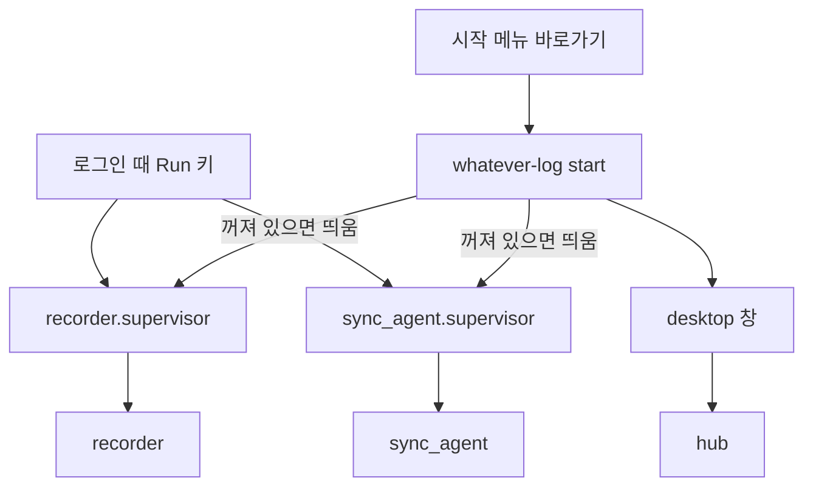

# 설치와 전체 실행 (`whatever-log` 명령)

> 아래는 저장소를 clone한 개발 모양 기준이다. **사용자에게 배포하는 방법(릴리스 번들·버전·데이터 위치)은 [릴리스 번들](#릴리스-번들-사용자용-배포)** 절.

프로젝트를 쓰려면 기록기(recorder)·동기화 에이전트(sync)를 로그인 때 자동으로 띄우고, 화면(hub + 데스크톱 창)을 열 길이 있어야 한다.
이 일을 한 명령으로 묶은 것이 `apps/launcher`의 `whatever-log`다. 저장소를 받은 상태에서 쓰는 방식이다(`uv sync` 뒤).

```
uv sync
uv run whatever-log install        # 한 번만
```

| 명령 | 하는 일 |
| --- | --- |
| `whatever-log install` | 화면 빌드(없을 때만) → 기록기·동기화 에이전트를 로그인 시 자동 시작에 등록 → 시작 메뉴 바로가기 → 지금 시작 |
| `whatever-log start` | 꺼져 있는 기록기·에이전트를 띄우고 창을 연다(시작 메뉴 바로가기가 하는 일) |
| `whatever-log stop` | 기록기·에이전트를 끈다(열려 있는 창은 그대로) |
| `whatever-log status` | 무엇이 떠 있고 무엇이 등록됐는지 본다 — 아무것도 바꾸지 않는다 |
| `whatever-log uninstall` | 끄고 자동 시작·바로가기를 지운다 |

- `install`은 여러 번 해도 같은 결과다. `--dry-run`은 할 일만 보여 주고, `--desktop-shortcut`은 바탕화면에도 바로가기를 만들며,
  `--skip-ui-build`·`--no-start`로 단계를 뺄 수 있다. 한 단계가 실패해도 나머지는 계속하고 끝에서 무엇이 안 됐는지 알린다
  (예: Node가 없어 화면을 빌드하지 못해도 기록기 등록은 된다).
- **`uninstall`은 이 설치본의 것만 지운다.** 다른 폴더(clone)가 등록한 자동 시작이나 만든 바로가기는 그대로 둔다(그쪽이 다음 로그인부터 안 뜨게 되므로). 못 끈 프로세스나 못 지운 바로가기는 지웠다고 하지 않고 `문제:`로 알리며 종료 코드 1로 끝난다(나머지 단계는 계속한다).
- **`uninstall`은 데이터를 지우지 않는다.** 기록·목표(`recorder.db`, `goals.db`)와 로그인 정보는 그대로다. 로그인 정보는 앱에서 로그아웃하면 지워진다.
- 자동 시작은 Registry Run 키(`HKCU\...\Run`)에 `pythonw.exe -m <supervisor>`로 등록한다(서비스는 Session 0 격리 때문에 쓰지 않는다 — `apps/recorder/src/recorder/autostart.py`).
  등록하는 것은 프로그램 자신이 아니라 **supervisor**다: 죽으면 다시 띄우고, 뜨자마자 계속 죽으면 포기한다(`packages/supervision`).

## 구성 요소와 프로세스



- 동기화 에이전트의 supervisor(`sync_agent.supervisor`)는 recorder.supervisor와 같은 모양이다. 로그인하지 않았거나 동기화를 켜지 않았어도 에이전트는 서버를 부르지 않고 건너뛰며 돌기 때문에 항상 떠 있어도 부담이 없다.
- **감독 없이 혼자 떠 있는 프로그램**(수동으로 띄웠거나 supervisor만 죽음)은 죽어도 다시 뜨지 않는다. `start`·`install`은 이를 알아보고 `whatever-log stop` 뒤에 다시 시작하라고 안내한다(supervisor를 새로 띄워도 프로그램의 중복 실행 lock 때문에 곧 멈추므로 억지로 띄우지 않는다). `status`에도 표시된다.
- launcher는 프로세스를 "**이 가상환경의 파이썬**이 **파이썬 자신의 옵션으로** `-m <모듈>`을 실행 중인 것"으로만 알아본다(`python -c '…' -m recorder`처럼 코드의 인자로 들어간 `-m`은 세지 않는다). 다른 폴더의 설치본이나 이름이 비슷한 프로그램은 건드리지 않는다.
  예외는 `install`이 자동 시작 등록을 넘겨받는 설치본 하나다: 등록이 다른 폴더를 가리키고 있으면 **그 등록이 가리키던 가상환경의** 기록기·에이전트를 끄고 넘겨받는다(업데이트 때 이전 폴더의 프로그램이 lock을 잡고 있으면 새 프로그램이 시작하지 못하므로).
- 시작하기 전에 프로그램의 중복 실행 lock(`recorder.db.lock`, `sync.lock`)을 다른 곳이 잡고 있는지 확인한다. 이 설치본의 프로세스가 없는데 lock이 잡혀 있으면(같은 데이터를 쓰는 다른 폴더의 설치본) 띄우지 않고 그 폴더에서 `whatever-log stop`을 하라고 알린다 — 띄워도 lock에 막혀 바로 멈추는데 "시작했다"고 하지 않기 위해서다.
- 끌 때는 supervisor를 먼저 끈다. 프로그램만 끄면 supervisor가 크래시로 보고 다시 띄운다.
- **자동 시작은 이 저장소의 가상환경을 가리킨다.** 다른 폴더(예: 다른 clone)에서 `install`하면 등록이 그쪽으로 바뀐다. 폴더를 옮기면 `install`을 다시 한다.

## 아이콘

- 원본은 `apps/desktop/src/desktop/assets/icon.svg`(전체)와 `icon-mark.svg`(작은 크기용)이다. **책으로 만든 `w`**(양 끝은 하드커버 색, 가운데는 흰 종이인 책 네 권)가 오른쪽 끝에 **세워 둔 책 한 권**(`l`)에 기대어 있어서 `wl`로도 읽힌다. 책 색은 화면의 포인트색(`--color-active`)의 진한 쪽 파랑이고, 글꼴에 기대지 않고 도형으로 그린다.
- `icon.ico`는 **크기별로 다른 그림**을 담는다: 16·24·32px은 mark(작은 크기에서 세부가 뭉개지므로 더 굵게), 48px 이상은 전체 아이콘이다. 바꿀 때만
  `uv run --with pillow python apps/desktop/tools/build_icon.py`로 다시 만든다(윈도우의 Edge로 SVG를 그리고 Pillow로 묶는다).
- `build_icon.py`는 Edge를 `--edge <경로>`, 환경변수 `EDGE_PATH`, 기본 설치 위치, PATH 순서로 찾고, 못 찾으면 해결 방법을 안내한다.
- 쓰이는 곳: 시작 메뉴·바탕화면 바로가기(`launcher.shortcuts`), 데스크톱 창의 제목 표시줄·작업표시줄(`desktop.window_icon`: AppUserModelID를 주고, 창이 실제로 보일 때(pywebview `shown` 이벤트) **이 프로세스가 연** 창에 `WM_SETICON`으로 아이콘을 붙인다), 화면의 favicon(`apps/ui/public/favicon.svg` = mark).

## 릴리스 번들 (사용자용 배포)

저장소를 통째로 받지 않고, 사용자 PC에 필요한 것만 **파이썬까지 담은** zip을 배포한다. 설치 명령은 같은 `whatever-log install`이고, 달라지는 건 내용물과 실행 파일이다.

| | 저장소를 clone해서 쓸 때(개발) | 릴리스 번들(사용자) |
| --- | --- | --- |
| 받는 것 | 저장소 전체(서버·테스트·문서 포함) | 앱·패키지 소스 + **미리 빌드한 화면** + **파이썬 런타임** |
| 필요한 것 | uv, Node.js | **없음**(uv·파이썬·Node 모두 불필요) |
| 설치 | `uv sync` → `uv run whatever-log install` | **`install.cmd`**(번들 안의 파이썬으로 `whatever-log install`을 실행) |
| 앱 창을 소유하는 프로세스 | `pythonw.exe` | **`whatever-log.exe`**(이름을 바꾼 pythonw) |
| 관리 명령 | `uv run whatever-log status` | `whatever-log.cmd status` |
| 데이터·로그 위치 | 앱 폴더 안(`apps/recorder/recorder.db` 등) | **`%LOCALAPPDATA%\whatever.log`** |

번들에 **들어가지 않는 것**: 서버(`apps/server`, Cloudflare는 사용자 PC에서 쓰지 않는다), 화면 소스와 Node 의존성, 테스트, 문서, Docker 파일, uv.

### 번들 구조와 파이썬 런타임

```
whatever-log-<버전>/
  install.cmd  whatever-log.cmd  release.json  VERSION  LICENSE  README.md
  runtime/                 파이썬 임베더블 배포판(python.org) + 의존성(Lib/site-packages)
    whatever-log.exe       pythonw.exe의 복사본(콘솔 없음) — 앱 창·기록기·hub가 이 이름으로 뜬다
    whatever-log-cli.exe   python.exe의 복사본(콘솔 있음) — 관리 명령(install 등)
    python314._pth         앱·패키지 소스 폴더를 모듈 검색 경로에 넣는다(runtime 기준 상대 경로)
  apps/<앱>/src  packages/<패키지>/src   개발 저장소와 같은 모양이라 경로 규칙(common.paths 등)이 그대로 맞는다
  apps/ui/dist
```

- **왜 실행 파일 이름을 바꾸나:** recorder는 "창을 가진 프로세스의 실행 파일 이름"을 기록한다. 앱 창은 파이썬이 소유하므로 이름이 `pythonw.exe`면 사용자의 다른 파이썬 프로그램과 구분되지 않고
  작업 관리자에도 Python으로 보인다. 이름을 바꾼 복사본이라 **Python 재단의 서명이 그대로 유지된다**(내용을 건드리지 않는다). 아이콘은 exe에 넣지 않고 창에 `WM_SETICON`으로 붙인다(넣으면 서명이 깨진다).
- 원래 이름(`python.exe`·`pythonw.exe`)은 번들에 남기지 않는다 — 어느 쪽으로 실행했는지에 따라 기록되는 이름이 갈리지 않게 하려는 것이다.
- **의존성**은 빌드할 때 `uv.lock` 그대로(`uv export` → `uv pip install --target`, 대상은 Windows·번들의 파이썬 버전) 설치해 넣는다. 사용자 PC에서는 아무것도 내려받지 않는다.
- **파이썬 버전**은 `.mise.toml`의 `python`(정확한 패치 버전) 한 곳에서 온다. 임베더블 zip은 python.org에서 받고 **SHA-256을 `scripts/build_release.py`에 박아 두고 확인한다**(다르면 빌드가 멈춘다). 버전을 올릴 때는 해시도 같이 바꾼다 — 안 바꾸면 빌드가 해시가 없다고 멈춘다(테스트가 확인한다).
- `_pth` 파일이 있으면 임베더블 파이썬은 환경변수와 현재 작업 폴더를 모듈 검색에서 무시한다 — 작업 폴더에 놓인 파일이 import되는 일이 없다.
- 코드 쪽: `supervision.autostart.pythonw_path()`가 "콘솔 없는 실행 파일"을 정한다. 지금 실행 중인 파이썬의 파일 이름이 `whatever-log(-cli).exe`면 번들이라서 같은 폴더의 `whatever-log.exe`를, 아니면 `pythonw.exe`를 쓴다
  (가상환경의 `Scripts`에도 `whatever-log.exe`(명령 실행기)가 있어서 "파일이 있는지"로 가리면 개발 환경에서 잘못 고른다).
- 번들은 약 15MB(압축 후)이고 풀면 약 30MB다.

### 데이터 위치 (`common.paths`)

번들 루트에 `release.json`이 있으면(번들에만 있다) 앱은 DB·로그·lock·아이콘 캐시를 **사용자 데이터 폴더**에 둔다. 그래서 새 버전을 새 폴더에 풀어도,
폴더를 지워도 기록과 목표가 남는다. 파일 이름은 그대로(`recorder.db`, `goals.db`, `sync.db`)이고, 로그만 `logs/` 아래에 모인다.
`WHATEVER_LOG_DATA_DIR` 환경변수가 있으면 두 모양 모두에서 그 폴더를 쓴다(상대 경로는 **설치 폴더 기준**이다 — 작업 디렉터리를 기준으로 하면 프로세스마다 다른 DB를 열게 된다).
경로를 정하는 것(`data_path`)은 **폴더를 만들지 않는다**: 앱 모듈은 import될 때 경로를 정하고 `status`·`--version`·`uninstall`도 그 모듈을 import하므로, 여기서 만들거나 실패하면 관리 명령까지 못 쓴다. 폴더는 실제로 쓰는 쪽(로그·lock·DB를 여는 곳)이 만든다. 번들인데 `LOCALAPPDATA`가 없으면 윈도우 표준 위치(`~/AppData/Local`)를 쓴다. 개발용 저장소(표시 파일 없음)는 기존 위치 그대로다.
hub·recorder·동기화 에이전트가 같은 DB를 앱 경계를 넘어 열기 때문에 경로는 앱마다 따로 정하지 않고 `data_path` 한 곳에서 정한다(테스트가 세 앱이 같은 곳을 가리키는지 확인한다).

### 버전

- 루트의 **`VERSION`** 파일 한 곳에서 온다. [SemVer](https://semver.org/lang/ko/) 형식이다.
  - `1.0.0` = 정식, `1.0.0-beta.1` = 베타, `1.0.0-rc.1` = 출시 후보. 하이픈 뒤에 뭔가 붙으면 시험 버전이다.
  - 처음에는 `1.0.0-beta.1`로 내보내고, 쓸 만하면 `1.0.0-beta.2`, … `1.0.0`으로 올린다. 호환이 깨지는 변경이면 앞자리(`2.0.0`), 기능 추가면 가운데(`1.1.0`), 고침이면 마지막(`1.0.1`)을 올린다.
- git 태그는 `v` + 버전이다(`v1.0.0-beta.1`). 번들 이름은 `whatever-log-<버전>-win64.zip`.
- 각 파이썬 패키지의 `version = "0.1.0"`은 **내부 값**이라 그대로 둔다(배포 버전과 무관).
- `whatever-log --version`과 `status`가 버전을 보여 준다(개발용 저장소는 ` (개발)`이 붙는다).

### 릴리스 만들기

```
# 1) VERSION을 올리고 main에 머지한다
# 2) 태그를 만들어 푸시한다 — 나머지는 GitHub Actions(.github/workflows/release.yml)가 한다
git tag v1.0.0-beta.1
git push origin v1.0.0-beta.1
```

Actions가 태그와 `VERSION`이 같은지 확인하고(다르면 멈춘다), 화면을 빌드해 번들을 만들고, **만든 zip을 사용자처럼 풀어 `install.cmd`로 설치해 본 뒤**(`--no-start`, 버전·자동 시작 등록·`uninstall`까지 확인) **GitHub Release**에 올린다(하이픈이 든 태그는 *pre-release*로 표시). 설치 시험이 실패하면 Release를 만들지 않는다. 릴리스 설명에 zip의 SHA-256이 적힌다.
태그를 만들기 전에 같은 과정을 예행연습하려면 Actions 화면에서 `release` 워크플로를 직접 실행한다(Run workflow). 번들 만들기와 설치 시험까지만 하고 Release는 올리지 않는다.
- **한 번 공개한 버전 번호는 다시 쓰지 않는다.** 잘못 나간 버전은 Release를 지우고(태그는 남긴다) 다음 번호로 낸다 — `v1.0.0-beta.1`이 그랬다(배포된 `install.cmd`가 LF 줄바꿈이라 cmd가 실행하지 못했다).
로컬에서 같은 번들을 만들어 보려면: `uv run python scripts/build_release.py`(결과는 `release-out/`, git이 무시한다). 같은 내용이면 같은 해시가 나온다.

### 사용자가 설치·업데이트하는 법

- **설치:** zip을 풀고 `install.cmd`를 실행한다(uv·파이썬은 필요 없다). 그 폴더가 앱의 자리가 되므로 **옮기지 않을 곳**에 푼다.
- **업데이트:** 새 zip을 **새 폴더**에 풀고 `install.cmd`를 실행한다. 자동 시작·바로가기가 새 폴더로 바뀌고, 이전 폴더에서 떠 있던 기록기·에이전트는 `install`이 끄고 새 폴더의 것을 띄운다.
  데이터는 사용자 데이터 폴더에 있어서 그대로 이어진다. 이전 버전의 창이 열려 있으면 닫고 시작 메뉴에서 다시 연다. 확인한 뒤 이전 폴더를 지운다.
- **제거:** 설치 폴더에서 `whatever-log.cmd uninstall`(데이터는 지우지 않는다). 데이터까지 지우려면 `%LOCALAPPDATA%\whatever.log` 폴더를 직접 지운다.

### 아직 없는 것

- **설치 마법사(.exe 설치 프로그램)**: PyInstaller처럼 파이썬을 한 파일로 묶는 방식은 쓰지 않았다(자식 프로세스를 `-m`으로 띄우는 구조를 다시 설계해야 하고, 서명 없는 exe는 백신 오탐이 잦다).
  대신 서명된 파이썬을 이름만 바꿔 쓴다. 설치 마법사가 필요해지면 이 번들 폴더를 그대로 담으면 된다.
- WebView2 런타임은 번들에 없다(Windows 11에는 기본으로 있다). Windows 10에서 창이 안 뜨면 Microsoft의 WebView2 런타임 설치가 필요하다.
- **코드 서명**, **자동 업데이트**(새 버전 알림·내려받기).
