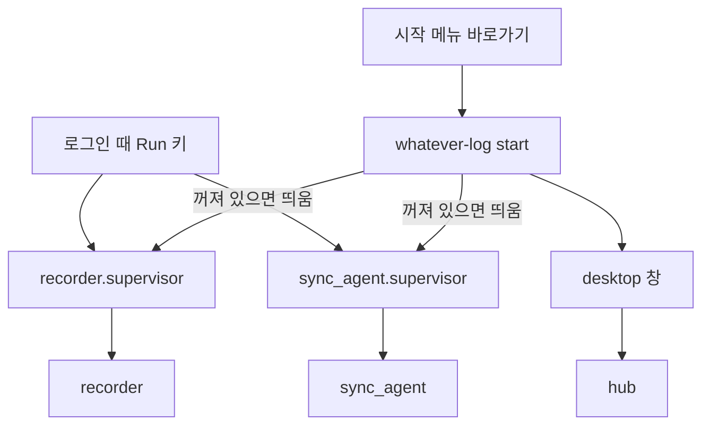

# 설치와 전체 실행 (`whatever-log` 명령)

프로젝트를 쓰려면 기록기(recorder)·동기화 에이전트(sync)를 로그인 때 자동으로 띄우고, 화면(hub + 데스크톱 창)을 열 길이 있어야 한다.
이 일을 한 명령으로 묶은 것이 `apps/launcher`의 `whatever-log`다. 저장소를 받은 상태에서 쓰는 방식이다(`uv sync` 뒤).

```
uv sync
uv run whatever-log install        # 한 번만
```

| 명령 | 하는 일 |
| --- | --- |
| `whatever-log install` | 화면 빌드(없을 때만) → 기록기·동기화 에이전트를 로그인 시 자동 시작에 등록 → 시작 메뉴 바로가기 → 지금 시작 |
| `whatever-log start` | 꺼져 있는 기록기·에이전트를 띄우고 창을 연다(시작 메뉴 바로가기가 하는 일) |
| `whatever-log stop` | 기록기·에이전트를 끈다(열려 있는 창은 그대로) |
| `whatever-log status` | 무엇이 떠 있고 무엇이 등록됐는지 본다 — 아무것도 바꾸지 않는다 |
| `whatever-log uninstall` | 끄고 자동 시작·바로가기를 지운다 |

- `install`은 여러 번 해도 같은 결과다. `--dry-run`은 할 일만 보여 주고, `--desktop-shortcut`은 바탕화면에도 바로가기를 만들며,
  `--skip-ui-build`·`--no-start`로 단계를 뺄 수 있다. 한 단계가 실패해도 나머지는 계속하고 끝에서 무엇이 안 됐는지 알린다
  (예: Node가 없어 화면을 빌드하지 못해도 기록기 등록은 된다).
- **`uninstall`은 데이터를 지우지 않는다.** 기록·목표(`recorder.db`, `goals.db`)와 로그인 정보는 그대로다. 로그인 정보는 앱에서 로그아웃하면 지워진다.
- 자동 시작은 Registry Run 키(`HKCU\...\Run`)에 `pythonw.exe -m <supervisor>`로 등록한다(서비스는 Session 0 격리 때문에 쓰지 않는다 — `apps/recorder/src/recorder/autostart.py`).
  등록하는 것은 프로그램 자신이 아니라 **supervisor**다: 죽으면 다시 띄우고, 뜨자마자 계속 죽으면 포기한다(`packages/supervision`).

## 구성 요소와 프로세스



- 동기화 에이전트의 supervisor(`sync_agent.supervisor`)는 recorder.supervisor와 같은 모양이다. 로그인하지 않았거나 동기화를 켜지 않았어도 에이전트는 서버를 부르지 않고 건너뛰며 돌기 때문에 항상 떠 있어도 부담이 없다.
- launcher는 프로세스를 "**이 가상환경의 파이썬**으로 `-m <모듈>`을 실행 중인 것"으로만 알아본다. 다른 폴더의 설치본이나 이름이 비슷한 프로그램은 건드리지 않는다.
- 끌 때는 supervisor를 먼저 끈다. 프로그램만 끄면 supervisor가 크래시로 보고 다시 띄운다.
- **자동 시작은 이 저장소의 가상환경을 가리킨다.** 다른 폴더(예: 다른 clone)에서 `install`하면 등록이 그쪽으로 바뀐다. 폴더를 옮기면 `install`을 다시 한다.

## 아이콘

- 원본은 `apps/desktop/src/desktop/assets/icon.svg`(전체)와 `icon-mark.svg`(작은 크기용)이다. **책으로 만든 `w`**(양 끝은 하드커버 색, 가운데는 흰 종이인 책 네 권)가 오른쪽 끝에 **세워 둔 책 한 권**(`l`)에 기대어 있어서 `wl`로도 읽힌다. 책 색은 화면의 포인트색(`--color-active`)의 진한 쪽 파랑이고, 글꼴에 기대지 않고 도형으로 그린다.
- `icon.ico`는 **크기별로 다른 그림**을 담는다: 16·24·32px은 mark(작은 크기에서 세부가 뭉개지므로 더 굵게), 48px 이상은 전체 아이콘이다. 바꿀 때만
  `uv run --with pillow python apps/desktop/tools/build_icon.py`로 다시 만든다(윈도우의 Edge로 SVG를 그리고 Pillow로 묶는다).
- 쓰이는 곳: 시작 메뉴·바탕화면 바로가기(`launcher.shortcuts`), 데스크톱 창의 제목 표시줄·작업표시줄(`desktop.window_icon`: AppUserModelID를 주고 `WM_SETICON`으로 아이콘을 붙인다), 화면의 favicon(`apps/ui/public/favicon.svg` = mark).

## 실행 파일(.exe)·설치 마법사는 아직 없다

넣지 않은 이유: PyInstaller 같은 도구로 묶으려면 pywebview(pythonnet·WebView2), 워크스페이스 패키지 10여 개, 화면 빌드 결과, 아이콘을 모두 맞춰야 하고,
Python 3.14·서명되지 않은 exe는 백신 오탐도 잦아서 "비용이 크지 않은" 일이 아니다. 지금의 `whatever-log` 명령 + 바로가기(아이콘 포함)로 같은 일을 한다.
exe가 필요해지면 이 명령(`launcher`)을 그대로 진입점으로 묶으면 되도록 동작을 `launcher.commands`에 모아 두었다.
