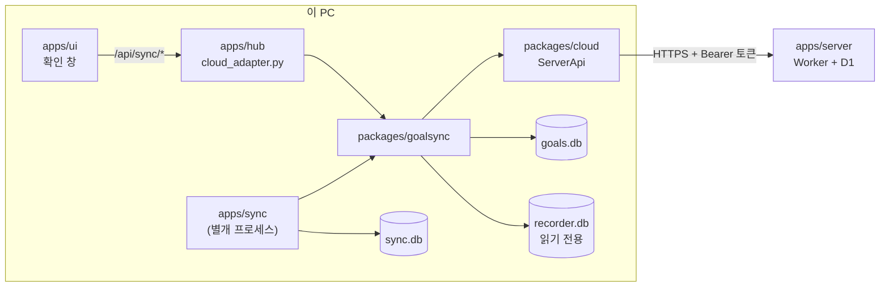
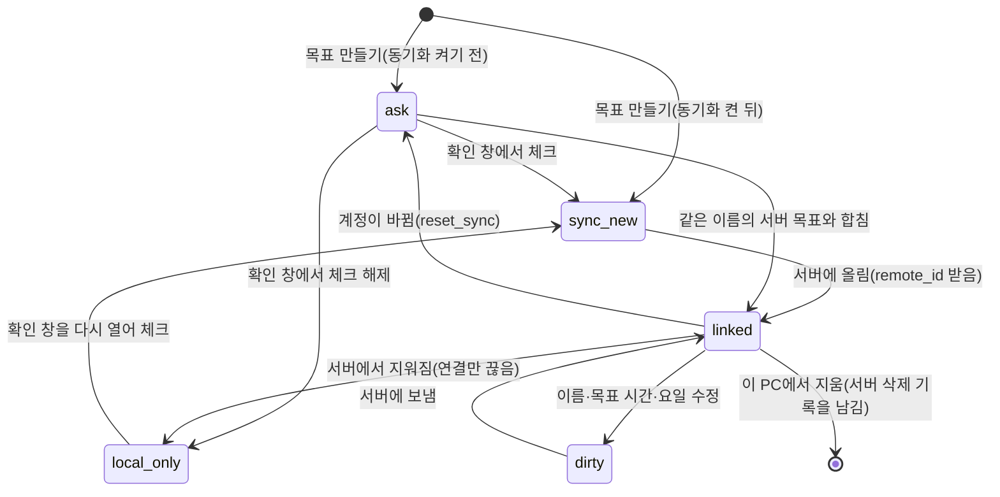
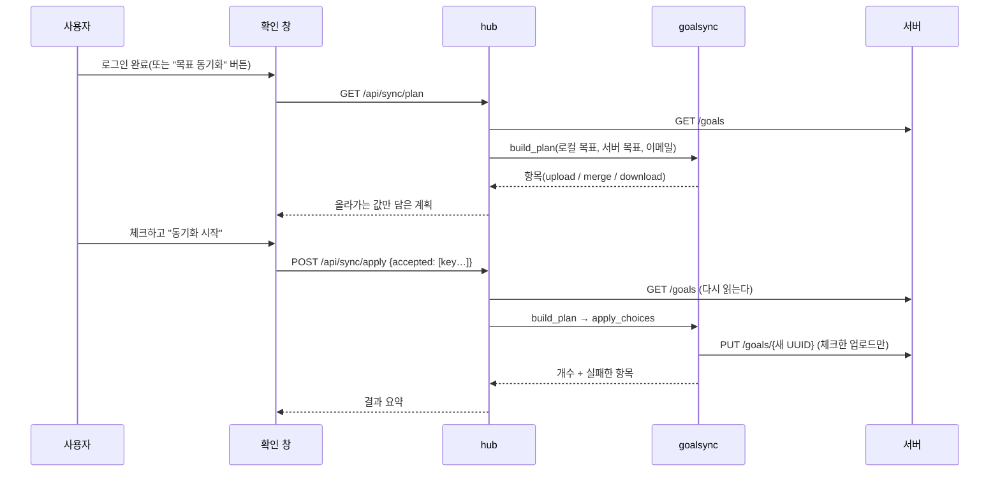
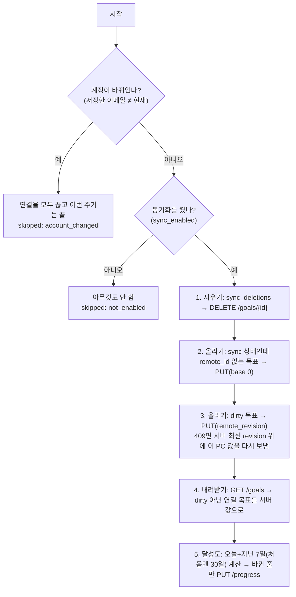
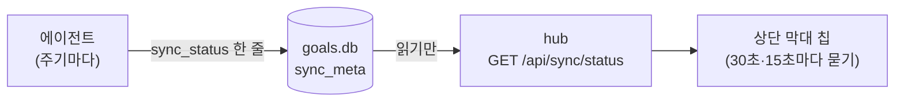
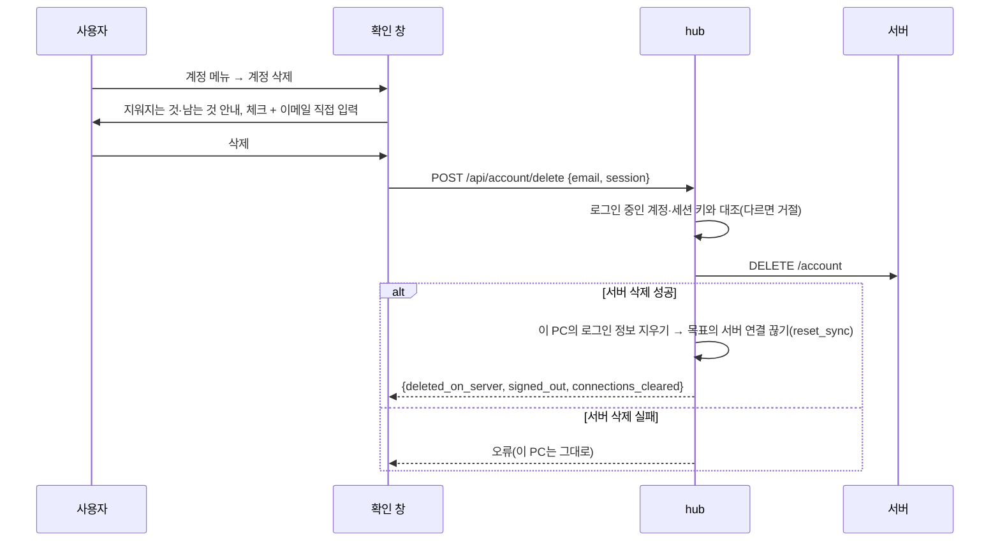

# 동기화 클라이언트 구조

로그인한 사용자의 **목표(이름·목표 시간·요일)** 와 **날짜별 달성 시간**을 이 PC에서 서버로 맞추는 쪽의 구조를 설명한다.
무엇을 서버에 두는지, 서버 API가 어떤지는 [docs/sync-design.md](sync-design.md)가, 로그인은 [docs/auth-design.md](auth-design.md)가,
사용자에게 약속한 내용은 [docs/data-handling.md](data-handling.md)가 기준이다. 이 문서는 그 약속을 **코드가 어떻게 지키는지**를 다룬다.

> 읽는 사람: 동기화 클라이언트를 고치거나 확장할 개발자.

## 한눈에 보기



- **두 입구, 같은 로직.** 사용자가 로그인 직후 고르는 단계는 hub가(화면이 부른다), 주기적으로 맞추는 단계는 에이전트가 한다. 둘 다
  `goalsync`를 부르므로 규칙이 한 곳에만 있다.
- **에이전트는 hub와 별개의 프로세스다.** 화면·hub 없이 혼자 돈다. 그래서 hub나 화면이 꺼져 있어도 동기화가 되고, 반대로 에이전트가 죽어도
  기록·집계·화면에는 영향이 없다.
- **서버로 가는 것은 하나의 통로(`cloud.ServerApi`)뿐이다.** 서버 응답의 모양을 아는 곳도 그 파일 하나다.

## 구성 요소

| 부분 | 위치 | 책임 | 모르는 것 |
| --- | --- | --- | --- |
| 서버 API 클라이언트 | `packages/cloud/src/cloud/api.py` | 토큰을 달아 `/goals`·`/progress`를 부르고, 응답을 엄격히 검사한다. 오류를 종류별 예외로 바꾼다(`NotAuthorized`·`GoalConflict`·`ServerUnreachable`·`ServerError`) | 로컬 DB, 목표의 의미 |
| 계획·적용 | `packages/goalsync/.../plan.py` | 로컬 목표와 서버 목표를 견줘 "올리기·합치기·가져오기" 계획을 만들고, 사용자의 선택을 적용한다 | 화면, HTTP |
| 주기 동기화 | `.../runner.py` (`sync_once`) | 올리기·지우기·내려받기·달성도 올리기를 순서대로 한 번 한다 | 언제 부를지(에이전트가 정한다) |
| 달성 분 계산 | `.../daily.py` | `recorder.db`에서 날짜별 달성 분을 뽑는다(수행 시간의 정의는 `goals.compute_progress`) | 서버 |
| 에이전트 상태 | `.../state.py` (`sync.db`) | 기기 ID와 서버에 마지막으로 보낸 달성 분 | 목표 |
| 에이전트 | `apps/sync` | 주기·재시도·백오프·중복 실행 잠금·로그·종료 코드. 토큰 저장소를 고른다 | 동기화 규칙 |
| hub 어댑터 | `apps/hub/src/hub/cloud_adapter.py` | 화면의 요청을 `goalsync`로 옮기고 실패를 사용자용 문장으로 바꾼다 | 동기화 규칙 |
| 확인 창 | `apps/ui/src/components/sync/` + `lib/syncBoard.ts` | 두 칸 목록으로 선택을 받는다. 순수 규칙(기본 선택, 문장)은 `lib`에 있다 | 서버, 토큰 |
| 로컬 저장 | `packages/goals` (`goals.db` 스키마 3) | 목표와 서버 연결 칸을 저장하고 규칙(CHECK·UNIQUE)으로 지킨다 | 서버 |

### 의존 방향과 격리

```
apps/sync ─┐
apps/hub ──┼─▶ packages/goalsync ─▶ packages/cloud
           │            └────────▶ packages/goals, packages/aggregation
```

- **로컬 기능은 `cloud`도 `goalsync`도 쓰지 않는다.** recorder·aggregation·goals·chromium·supervision·desktop이 import하거나 의존성에 넣으면
  `packages/cloud/tests/test_isolation.py`가 실패한다(소스·pyproject·`cloud`/`goalsync` import를 막은 프로세스에서의 실제 import를 모두 본다).
- **hub는 예외 하나**다: 화면의 확인 창이 hub를 거치기 때문이다. 그래도 hub가 서버 쪽을 아는 곳은 어댑터 한 파일이고, 그 import는 함수 안에만
  있다. `cloud`를 불러오지 못해도 hub는 뜨고 계정·동기화 기능만 "사용할 수 없음"(503)이 된다.
- `goals`는 서버를 모른다. 서버 연결 칸은 값만 저장하고, 무엇을 언제 보낼지는 `goalsync`가 정한다.

## 데이터

### `goals.db` 스키마 3 — 서버와의 연결 칸

| 칸 | 뜻 |
| --- | --- |
| `sync_state` | `ask`(아직 안 물음) / `sync`(서버와 동기화함) / `local_only`(사용자가 올리지 않기로 함) |
| `remote_id` | 서버의 목표 UUID. 비어 있으면 아직 서버에 없다(`UNIQUE`: 한 서버 목표를 두 목표가 가질 수 없다) |
| `remote_revision` | 서버와 마지막으로 맞춘 `revision`(낙관적 잠금용) |
| `dirty` | 연결된 목표의 이름·목표 시간·요일을 이 PC에서 고쳐 아직 서버에 못 보냈다 |

별도 테이블: `sync_deletions`(이 PC에서 지운 연결 목표의 서버 ID — 서버에 알리기 전까지), `sync_meta`(`sync_enabled`, `account_email`).
v2에서 올라올 때 칸만 더하고 기존 목표는 모두 `ask`다(재실행해도 안전하다 — 이미 있는 칸은 건너뛴다).

**프로세스·사이트 연결 테이블은 동기화와 무관하다.** 프로세스 연결만 바꾸는 수정은 `dirty`를 켜지 않는다(`UPDATE`가 서버가 아는 세 칸이 바뀐
경우에만 켠다). 그래서 연결을 바꿀 때마다 서버 revision이 올라가는 일이 없다.

### 목표 하나의 동기화 상태



`sync_new`는 `sync_state='sync'`이고 `remote_id`가 아직 없는 상태, `linked`는 `remote_id`가 있는 상태, `dirty`는 `linked`에 `dirty=1`이 켜진 상태다.

### `sync.db` (에이전트 전용)

기기 ID(처음 실행할 때 만든 무작위 UUID — 하드웨어 값이 아니다)와, 서버 목표·날짜별로 마지막에 보낸 (분, 목표 분). 같은 값은 다시 보내지
않는다. `goals.db`와 파일을 나눈 이유는 쓰기 주체를 섞지 않으려는 것이다(`goals.db`는 hub와 에이전트가 함께 쓰는데, WAL 모드와
`BEGIN IMMEDIATE`로 직렬화한다).

## 흐름 1 — 로그인 직후: 무엇을 올릴지 정한다



- **계획 항목:** `upload`(이 PC에만 있는 목표), `merge`(같은 이름의 서버 목표가 있음 — 대소문자·유니코드 표현은 무시), `download`(서버에만 있는 목표).
  이미 연결됐거나 `sync`로 정해 둔 목표는 묻지 않고, 전에 "올리지 않기"를 고른 목표는 목록에 있되 체크가 꺼져 있다.
- **합치기**는 새로 올리지 않고 그 서버 목표에 연결한다. 목표 시간·요일은 **서버 값**으로 맞추고 이 PC의 프로세스 연결은 그대로 둔다. 값이 다르면 화면이
  선택 전에 두 값을 함께 보여 준다.
- **적용은 서버를 다시 읽어 계획을 새로 만든 뒤** 같은 `key`의 항목에 적용한다(계획을 본 사이에 다른 기기가 목표를 만들었어도 안전하다 — 예를 들어
  업로드하려던 이름이 그 사이 생겼다면 오류 대신 합치기가 된다). 체크하지 않은 이 PC 목표는 `local_only`가 된다. 체크하지 않은 **서버 목표는
  가져오지 않고 서버에만 남는다**(화면은 이 칸을 "동기화하지 않음"으로 부르고 항목에 "서버에만 있음 · 이 PC로 가져오지 않음"이라고 적는다).
- **확인한 계정에 묶는다.** 계획의 `email`을 적용 요청에 함께 보내고(`POST /api/sync/apply`의 `email`), hub가 지금 로그인한 계정과 다르면
  **서버를 부르지도 않고 거절한다.** 확인 창을 연 사이에 다른 계정으로 로그인했을 때, 계정 A에서 고른 목표가 계정 B에 올라가거나 B의 목표와 합쳐지는 것을 막는다.
  거절되면 창을 다시 열어 새 계획을 받아야 한다.
- **먼저 `sync_enabled`와 계정 이메일을 기록한 뒤 처리한다.** 처리 도중 네트워크가 끊겨도 사용자는 이미 동의했고, 못 올린 목표는 `sync` 상태로
  남아 에이전트가 다음 주기에 올린다(재시작해도 이어진다). 항목 하나가 실패해도 나머지는 계속한다.
- 동시에 두 번 적용하면 두 번째는 409다(hub가 잠금을 둔다).

## 흐름 2 — 주기마다 (`sync_once`)



**순서가 규칙이다: 이 PC의 수정을 먼저 올리고 나서 내려받는다.** 그래서 방금 한 수정이 서버의 낡은 값에 덮이지 않는다. 같은 일을 하는 안전장치가 하나 더
있다 — 내려받기는 `dirty`인 목표를 건너뛴다(올리기가 이름 중복 등으로 실패해 수정이 남아 있어도 사용자의 수정이 사라지지 않는다).

### 충돌과 예외를 어떻게 다루나

| 상황 | 동작 | 이유 |
| --- | --- | --- |
| 두 기기가 같은 revision에서 동시에 수정(409 `conflict`) | 서버의 최신 revision 위에 **이 PC의 값을 다시 보낸다**(한 번만). 늦게 올린 쪽의 값이 서버에 남고, 먼저 올린 기기는 다음 주기에 서버 값을 받아 온다 | 이 PC에서 방금 한 수정이 사용자 눈에 보이는 값이라 되돌리면 더 놀랍다. 필드별 병합은 하지 않는다(통합 시험으로 확인) |
| 수정하려는 목표가 다른 기기에서 지워짐(409 `goal_deleted`, 또는 404) | 지우지 않고 연결만 끊는다(`local_only`) | 프로세스 연결이 사라지는 되돌릴 수 없는 일을 조용히 하지 않는다 |
| 서버에서 지워졌거나 서버가 전혀 모르는 연결 목표(내려받기에서) | 위와 같이 연결만 끊고, 보낸 달성 기록도 잊는다 | 같은 이유 |
| 서버가 준 목표 시간·요일이 이 PC의 규칙에 맞지 않음(0분, 빈 요일 등) | 저장하지 않고 그 칸을 짚어 알린다(이름 중복으로 둔갑시키지 않는다) | 원인을 숨기지 않는다 |
| 서버가 이 토큰을 거부함(401) | 화면 쪽(hub)은 이 PC의 로그인 정보를 지워 로그인 버튼이 보이게 한다. 에이전트는 경고만 남기고 계속 돈다 | 로그인된 것처럼 보이는데 아무것도 안 되는 상태를 막는다 |
| 이름이 서버의 다른 목표와 겹침(409 `duplicate_name`) | 새 목표면 `local_only`로 두고 알린다. 수정이면 `dirty`를 유지하고 알린다 | 조용히 합치지 않는다. 사용자가 이름을 바꾸면 다음 주기에 올라간다 |
| 서버에 목표 20개 초과(`too_many_goals`) | 알리고 `sync` 상태로 남겨 다음 주기에 다시 시도 | 사용자가 정리하면 풀린다 |
| 이 PC에서 지운 연결 목표 | `sync_deletions`에 서버 ID를 남기고, 서버 삭제에 성공한 뒤에만 지운다. 서버에 이미 없어도 성공으로 본다 | 오프라인에서 지워도 서버 삭제가 사라지지 않는다 |
| 내려받은 이름이 이 PC의 다른 목표와 겹침 | 반영하지 않고 알린다 | 이름은 목표마다 하나뿐이다 |
| 네트워크 끊김(`ServerUnreachable`) | 이번 주기를 접고 다음 주기에 다시. 상태는 DB에 남아 이어진다 | 모든 단계가 다시 실행해도 안전하다 |
| 토큰 만료·폐기(`NotAuthorized`) | 에이전트는 경고만 남기고 계속 돈다(다시 로그인하면 이어진다) | 로그인은 화면에서 한다 |
| 계정이 바뀜 | 이전 계정의 연결·삭제 기록·보낸 달성 기록을 모두 끊고 확인 창을 다시 열게 한다 | 다른 계정에 이전 계정의 목표가 올라가거나 지워지지 않게 |

### 달성도 계산

- 하루의 경계는 이 PC의 **로컬 시간대 자정**이다(서머타임 날도 다음 날 자정을 직접 구한다). 서버는 날짜(`YYYY-MM-DD`)만 안다 — 몇 시에 했는지는 모른다.
- 그날의 목표 설정은 하루 스냅샷(`GoalStore.snapshots`)이 있으면 그것을, 없으면 지금 목표를 쓴다. 분은 활성 초를 반올림해 0~1440으로 자른다.
- 그날 요일에 적용되지 않는 목표는 달성 분이 0이면 줄을 만들지 않는다(쉬는 날의 빈 줄을 서버에 쌓지 않는다).
- 한 번에 최대 50줄씩 나눠 보낸다. 서버가 "없는 목표"라고 돌려준(`ignored_goal_ids`) 줄은 보낸 것으로 기록하지 않는다.
- **어떤 프로세스에서 나온 시간인지는 여기서 계산하고 버린다.** 서버로 가는 값에도, 에이전트 로그에도 프로세스·사이트·목표 이름이 없다(시험으로 확인한다).

## 에이전트 (`apps/sync`)

```
uv run python -m sync_agent                       # 5분마다 계속
uv run python -m sync_agent --once                # 한 번만(시험·수동)
uv run python -m sync_agent --once --token-from-env   # 자격 증명 관리자 없이 환경 변수 WHATEVER_LOG_TOKEN으로
```

| 항목 | 동작 |
| --- | --- |
| 토큰 | 기본은 Windows 자격 증명 관리자(`KeyringTokenStore`). `--token-from-env`는 읽기 전용 저장소(`EnvTokenStore`)로, 토큰을 디스크에 남기지 않고 저장·삭제를 거부한다 |
| 로그인 | 안 되어 있으면 건너뛴다(오류 아님). 로그인은 에이전트가 아니라 화면(또는 `python -m cloud login`)에서 한다 |
| 주기 | `--interval`(기본 300초, 최소 5초). 연속 실패하면 두 배씩 늘려 최대 1시간, 한 번 성공하면 원래 주기로 돌아온다 |
| 중복 실행 | `sync.lock`으로 막는다(이미 실행 중이면 종료 코드 3) |
| 종료 코드 | 0 성공, 1 실패(`--once`) 또는 더 새 버전의 DB, 2 인자 오류 |
| 로그 | `apps/sync/sync.log`(회전). 개수·종류만 남기고 목표 이름·프로세스·토큰은 남기지 않는다. 문제는 **건수만** 남긴다(문제 문장에는 목표 이름이 들어 있을 수 있다) |
| 예상 못 한 오류 | 한 주기의 오류가 에이전트를 죽이지 않는다(다음 주기에 다시) |
| DB 위치 | `--goals-db`(기본 `apps/hub/goals.db`), `--db-path`(recorder.db), `--state-db`(기본 `apps/sync/sync.db`). 기본값은 hub·recorder와 같은 **저장소 체크아웃 기준 경로**다 — 이 프로젝트는 아직 설치형(wheel) 배포가 없고 hub도 같은 가정을 쓴다. 설치형 배포를 만들 때 세 프로세스가 공유하는 데이터 폴더 설정을 한꺼번에 도입한다 |

**지금은 desktop이 에이전트를 함께 띄우지 않는다.** 직접 실행해야 하고, 돌지 않으면 이후 수정과 달성 시간이 서버에 반영되지 않는다(확인 창의 "적용"만
즉시 서버를 부른다). 이 점은 확인 창 안내에도 적혀 있다.

## 화면 쪽

- hub 엔드포인트: `GET /api/sync/plan`(계획), `POST /api/sync/apply`(`{"accepted": [key…]}`). 출처·Host·본문 검사는 다른 쓰기 API와 같다
  (`docs/auth-design.md`). 응답에는 올라가는 값만 있고 토큰·프로세스·내부 id는 없다. 로그인 전·만료는 409, 서버에 닿지 못하면 503이다.
- 확인 창의 상태(계획, 체크, 처리 중, 결과)는 창 안의 일시적 상태라 저장소 없이 클로저에 둔다. 계획은 열 때마다 새로 받는다(`docs/ui-state.md`).
- **언제 자동으로 열리나:** 로그인이 막 끝난 순간(로그인 중 → 로그인됨)에만, 이 계정에서 처음이고 정할 것이 있을 때. 서버에 닿지 못하면 조용히 넘어간다.
  이후에는 상단 막대의 "목표 동기화" 버튼으로 연다.

## 시험

| 대상 | 위치 | 방법 |
| --- | --- | --- |
| `goals.db` 연결 칸·마이그레이션 | `packages/goals/tests/test_sync_links.py` | 실제 SQLite, v2 DB를 직접 만들어 올려 본다 |
| 서버 API 클라이언트 | `packages/cloud/tests/test_api.py` | 실제 HTTP 서버(응답 모양 검증, 오류 종류, 끊긴 응답) |
| 계획·적용·주기 동기화 | `packages/goalsync/tests/` | 서버 규칙을 흉내 낸 메모리 서버 + 실제 `goals.db`·`recorder.db` |
| 에이전트 | `apps/sync/tests/test_main.py` | 주기·백오프·종료 코드·로그에 이름이 없음 |
| hub 확인 API | `apps/hub/tests/test_sync_api.py` | 실제 hub 서버 + 실제 어댑터 + 가짜 서버 API |
| 격리 | `packages/cloud/tests/test_isolation.py` | import 스캔, pyproject 스캔, `cloud`·`goalsync`를 막은 프로세스에서 hub 시작 |
| 실제 서버와의 일치 | `apps/sync/tests/test_e2e_server.py` | 진짜 Worker + D1(서버가 떠 있을 때만) |

메모리 서버는 실제 서버 규칙을 사람이 옮겨 적은 것이라 어긋날 수 있다. 통합 시험이 그 어긋남을 잡는 유일한 시험이다(서버 규칙을 바꾸면 이 시험을 꼭 돌린다).
핵심 규칙(올리기가 내려받기보다 먼저, `local_only`는 업로드하지 않음, 삭제는 성공 뒤에 기록을 지움, 계정이 바뀌면 중단 등)은 일부러 깨뜨려 시험이 실패하는지
확인했다.

### 서버를 로컬에서 띄워 통합 시험 하기

```
docker compose up -d server                                   # Worker + 로컬 D1을 127.0.0.1:8790에(마이그레이션 자동)
TOKEN=$(docker compose exec -T server node scripts/dev-token.mjs e2e@example.com)
WHATEVER_LOG_E2E_SERVER=http://127.0.0.1:8790 WHATEVER_LOG_E2E_TOKEN=$TOKEN \
  uv run pytest apps/sync/tests/test_e2e_server.py
docker compose down                                           # 로컬 DB는 볼륨에 남는다(지우려면 down -v)
```

- 로그인(Google)은 비밀 키와 브라우저가 필요해 시험에서 쓰지 않는다. `dev-token.mjs`가 **로컬 D1에만** 시험용 사용자와 토큰을 넣는다(`--remote`는 거부).
  서버 코드에는 인증을 건너뛰는 길이 없다.
- `docker-compose.yml`의 `server`는 저장소를 바인드 마운트하므로, 컨테이너의 `pnpm install`이 호스트의 `node_modules`를 건드리지 않게 node_modules가 있는
  워크스페이스(루트, `apps/server`, `apps/ui`)를 모두 이름 붙은 볼륨으로 가렸다. **새 워크스페이스에 node_modules가 생기면 compose에도 더한다.**
- 이미지에는 `ca-certificates`가 필요하다(workerd가 시작할 때 시스템 인증서를 읽는다).
- recorder는 Windows 화면을 읽으므로 컨테이너에서 돌지 않는다. 컨테이너에는 서버만 있다.

## 지금 있는 것 / 없는 것

- 있는 것: 위의 모든 것(동기화 상태 칩, 기기 관리, 계정 삭제 포함 — 아래 "상태 표시·기기·계정 삭제"). 서버 API는 **아직 Cloudflare에 배포되지 않았다**(마이그레이션 `0002`와 `wrangler deploy`가 필요하다).
- 알려진 한계: 서버의 목표 이름 비교 키(`nameKey`)를 로컬 `casefold`와 같은 묶음으로 맞췄다(`Straße`와 `STRASSE`는 같은 이름). JS에는 `casefold`가 없어 "대문자로 바꿨다가 소문자로"에 두 글자(`ı`, `ẞ`)를 따로 처리한다 — 처음에는 `ı`가 `i`와 합쳐지고 `ẞ`가 `ss`와 갈라지는 어긋남이 있었고(리뷰 지적), `packages/goals/tests/test_name_key_parity.py`가 서버 코드를 실제로 실행해 모든 유니코드 글자로 비교한다. 남는 한계: 파이썬(유니코드 16)과 Workers 런타임(더 새 버전)의 유니코드 버전이 다르면 새 버전에서 추가된 글자의 대소문자 관계가 어긋날 수 있다(Garay 같은 극히 드문 문자 28개가 지금 해당). 서버 DB에 이미 올라간 목표가 있다면
  그 행의 `name_key`는 옛 규칙으로 저장돼 있다 — 서버가 배포되기 전이라 지금은 해당이 없지만, 배포 뒤에 이 규칙을 바꾸면 기존 행의 키를 다시 계산하는 마이그레이션이 필요하다.
- 없는 것(다음 후보): desktop이 에이전트를 함께 띄우고 감시하는 것(지금은 직접 실행하고, 안 돌면 화면의 상태 칩이 "에이전트 멈춤"으로 알린다),
  모바일 클라이언트, 서버의 요청 횟수 제한.

## 상태 표시·기기·계정 삭제

### 동기화 상태 표시

화면 상단 막대의 칩("동기화됨 · 5분 전", "에이전트 멈춤 · 2시간 전", "동기화 오류" …)이 지금 동기화가 되고 있는지를 알려 준다. 동기화를 켜지 않았으면 칩을
그리지 않는다.



- **에이전트가 주기마다 결과를 적는다** (`goals.sync_status.record`): 마지막 시도 시각, 결과 종류, 마지막 성공 시각, 이번 주기의 문제 건수, 주기(초). 성공·실패·건너뜀·예상 못 한
  오류 모두 적는다. 상태를 못 적어도 동기화는 멈추지 않는다(상태는 알림일 뿐이다). **목표 이름·프로세스·토큰은 들어가지 않는다**(건수와 종류뿐 — 시험으로 확인한다).
- **`goals.db`의 `sync_meta`에 JSON 한 줄로 둔다.** hub와 에이전트가 이미 함께 쓰는 DB라 경로 설정이 늘지 않고, 한 줄이라 쓰는 도중에 읽어도 반쪽짜리 값을 보지 않는다.
  계정이 바뀌어 연결을 끊을 때(`reset_sync`)는 함께 지워진다. 이 로직은 서버를 부르지 않으므로 `goalsync`가 아니라 `goals`에 둔다 — `cloud`·`goalsync`가 깨져도 hub가 읽을 수 있다.
- **세대(generation)로 낡은 주기를 거른다.** 계정 정리(`reset_sync`: 계정이 바뀌었거나 계정 삭제)마다 `sync_meta`의 `sync_generation`이 1씩 올라간다(지워지지 않는다). 에이전트는 주기 시작 때의 세대를
  들고 있다가 **연결·상태를 바꾸는 모든 쓰기**에서 확인시킨다(`goals.StaleSyncError`). 주기가 도는 사이에 화면에서 계정을 삭제하면, 그 뒤의 낡은 쓰기(방금 받은 업로드 응답의 연결 저장, 이전 계정 주기의 "성공" 상태
  기록)는 거절되어 정리된 DB에 이전 계정의 흔적이 되살아나지 않는다. 쓰기는 `BEGIN IMMEDIATE`로 잠근 직후 세대를 확인하므로 확인과 저장이 원자적이다.
- **상태 판정** (`describe`): 동기화 꺼짐 → `off`(에이전트가 돌든 말든 칩 없음) / 켰는데 기록 없음 → `waiting`(에이전트를 한 번도 안 돌림) / 마지막 기록이 **주기의 3배(최소 2분)**보다
  오래됨 → `stale`(에이전트가 꺼져 있음, 마지막 시도가 실패였어도 "오류"가 아니라 "멈춤"으로 본다. 기준에 쓰는 주기는 **실제로 기다리는 시간**(백오프 포함)을 적은 값이라, 연속 실패로 20분을 기다리는 멀쩡한 에이전트가 "멈춤"으로 보이지 않는다) / 마지막 시도가 서버 연결 실패·로그인 만료·서버 오류·내부 오류 → `error` / 그 밖 → `ok`
  (동기화 꺼짐·계정 바뀜으로 건너뛴 주기는 오류가 아니다. **로그인 안 됨은 오류다** — 화면은 로그인되어 있는데 에이전트가 로그인 정보를 못 찾는다는 뜻이라 이후 변경이 반영되지 않는다. 낡은 "동기화됨"을 두지 않는다). 주기가 늘어나는 백오프도 감안해 기준을 주기 배수로 잡았다.
- **`GET /api/sync/status`** 는 이 PC의 `goals.db`만 읽고 서버를 부르지 않으며 로그인하지 않아도 답한다.
- 칩은 버튼이라 **키보드로 포커스해 Enter/Space로 자세한 안내(팝업)를 볼 수 있다**(마우스를 올리면 나오는 title은 보조). 정상일 때 30초, 문제가 있을 때 15초, 꺼짐일 때 60초마다 다시 묻고, 상태를 읽지 못해도(hub가 꺼짐 등) 오류를 띄우지 않는다(그 상황은 계정 영역이 알린다). 색에만 기대지 않도록
  항상 글자를 함께 보여 주고, 무엇을 하면 되는지(`uv run python -m sync_agent` 실행, 다시 로그인 등)는 마우스를 올리면 나온다.

### 기기 관리

- 서버에 **`GET /devices`**(기기 ID·마지막으로 보낸 시각·줄 수)를 더했다. **기기에는 이름이 없다** — 이름을 받으면 PC 이름 같은 새 개인 정보가 서버에 생기므로,
  화면은 무작위 기기 ID의 앞 6글자와 마지막으로 보낸 시각으로 구분한다.
- **이 PC의 기기 ID는 에이전트가 `goals.db`에 적어 둔다**(`sync_meta`의 `device_id`, 주기마다). hub와 에이전트가 이미 함께 쓰는 DB라 경로를 따로 맞출 필요가 없다 —
  hub의 `--sync-db-path`와 에이전트의 `--state-db`가 어긋나 있어도 이 기기를 알아본다. goals.db에 아직 없으면(에이전트가 이 버전으로 한 번도 안 돌았다) 에이전트의
  `sync.db`를 읽기 전용으로 엿본다(`goalsync.peek_device_id` — 파일을 만들거나 바꾸지 않는다). 계정이 바뀌어도(`reset_sync`) 같은 기기이므로 기기 ID는 지우지 않는다.
- **이 기기의 기록은 지울 수 없다**(hub가 거절): 에이전트가 다음 주기에 다시 보내므로 지워도 소용이 없고, 동기화를 끄려면 로그아웃해야 한다. 다른 기기는 두 번 눌러서(경고 문구 확인 뒤) 지운다.
  기기는 사용자당 10대까지라, 쓰지 않는 기기의 기록을 지워 자리를 비우는 용도다.
- **이 기기를 확인할 수 없으면 지우지 않는다.** 동기화를 켰는데 이 PC의 기기 ID가 아직 알려지지 않았다면(에이전트가 한 번도 안 돎) 거절하고 에이전트를 한 번 실행하라고 안내한다 — 모르는 채로
  지우면 이 PC의 기기를 지울 수 있고, 지운 줄은 에이전트의 "이미 보냄" 기록 때문에 값이 바뀌기 전에는 다시 올라오지 않는다. 동기화를 켜지 않았다면 이 PC가 올린 기록이 없으므로 지울 수 있다.
- **목록을 본 로그인에 묶는다.** 기기 목록 응답에 `email`과 `session`이 있고, 지우기 요청(`DELETE /api/devices/<id>?email=…&session=…`)이 둘을 되돌려 보낸다. 지금 로그인과 다르면 거절한다(계정 A의 목록에서 누른
  삭제가 B의 기록을 지우지 않게). **`session`은 토큰에서 만든 불투명한 키**(토큰의 해시 일부, 토큰은 알 수 없다)라서, 이메일을 알 수 없는 두 계정(둘 다 `null`)이나 같은 이메일로 다시 로그인한 경우도 구분한다. 동기화 적용(`/api/sync/apply`)과 계정 삭제(`/api/account/delete`)도 같은 이유로 `email`+`session`을 함께 받는다.
- **이 PC의 기기 ID는 후보를 모두 지킨다.** 에이전트의 상태 DB를 바꾼 직후에는 `goals.db`의 옛 ID와 `sync.db`의 새 ID가 다를 수 있다. 어느 쪽이 현재인지 단정하지 않고 둘 다 "이 기기"로 보고 지우지 않는다. 에이전트는 주기를 시작하기 전에 현재 ID를 `goals.db`에 먼저 적는다.
- 남의 기기 ID로 지우려 해도 서버가 내 데이터만 대상으로 해서 아무 일도 없다(실제 서버로 확인).

### 계정 삭제



- **순서가 규칙이다: 서버 삭제가 성공한 뒤에만 이 PC를 정리한다.** 서버 삭제가 실패하면 이 PC의 로그인·동기화 연결은 그대로 둔다 — 계정은 남아 있는데 이 PC만 로그아웃되어
  지울 방법을 잃는 일이 없게 한다. 서버에서 이미 지워진 뒤에는 되돌릴 수 없으므로, 이 PC의 정리가 일부 실패해도 "서버 계정은 삭제됐다"를 먼저 알리고 남은 일(로그아웃)을 안내한다.
- **이 PC에는 아무것도 지우지 않는다.** 기록·목표·프로세스 연결은 그대로 두고, 목표의 서버 연결 표시와 동기화 설정만 끊는다(다시 로그인하면 처음처럼 확인받는다).
- **확인:** 화면은 "되돌릴 수 없다는 것을 이해했어요" 체크와 **계정 이메일 직접 입력**을 모두 요구한다(이메일을 알 수 없는 로그인은 체크만). hub는 요청의 `email`이 지금 로그인한 계정과
  다르면 서버를 부르지도 않고 거절한다(확인 창을 연 사이에 계정이 바뀐 경우).
- **삭제하는 동안 새 로그인은 시작하지 못한다**(409). 삭제 뒤 정리가 방금 끝난 새 로그인의 세션을 지우게 되기 때문이다. 진행 중인 로그인은 먼저 취소하고 끝나기를 잠깐 기다린다(지운 계정으로 마무리되지 않게). 동기화 적용과는 동시에 하지 않는다. 서버가 이 토큰을 이미 거부했다면(401) 이 PC의 로그인 정보를 지우고 로그인이 필요하다고 알린다.
- **응답을 받지 못했다면(연결 끊김·시간 초과) 결과를 단정하지 않는다.** 서버가 이미 지웠을 수 있으므로 hub는 `504`로 "서버에서 계정이 지워졌는지 확인하지 못했어요 … 다시 시도해 주세요"를 알리고 이 PC는 그대로 둔다. **로그아웃은 삭제의 증거가 아니다**(토큰이 만료·폐기돼도 로그아웃으로 보인다) — 그래서 그렇게 말하지 않는다. 서버가 명시적으로 거부한 경우(`503`)와는 다르다 — 그때는 "이 PC의 로그인 정보는 그대로 두었어요"라고 말할 수 있다.
- **불확실한 삭제는 표시를 남긴다.** `504`일 때 `goals.db`의 `sync_meta`에 `deletion_uncertain`=그 로그인의 세션 키를 적는다. 계정 상태 응답은 지금 세션과 같을 때만 `deletion_uncertain: true`를 주고, 화면은 계정 영역에 "다시 시도해 주세요" 안내를 계속 보여 준다(다른 로그인에는 근거 없는 경고를 띄우지 않는다). 다시 시도해 성공하면 표시를 지운다. 그 뒤 서버가 토큰을 거부(401)하면 계정이 지워졌을 가능성이 크므로, 로그인 정보와 함께 **동기화 연결(`reset_sync`)도 정리**한다 — 같은 이메일로 다시 가입해도 목표가 서버 연결을 가진 채로 "이미 올림"이 되어 확인 창에서 빠지는 일이 없게 한다. 표시가 없는 일반 만료(401)는 연결을 끊지 않는다(같은 계정으로 다시 로그인하면 이어진다).
- **401은 그 요청이 쓴 토큰의 로그인만 지운다.** 요청이 오가는 사이 다른 계정으로 로그인했다면, 옛 토큰에 대한 거부가 새 로그인의 자격 증명을 지우지 않는다(요청마다 쓴 토큰을 기억해 지금 토큰과 같을 때만 정리한다).
- **삭제는 진행 중인 로그인이 마무리되기를 기다린다.** 서버와 코드를 교환하는 중인 로그인이 삭제 뒤에 끝나면 서버가 계정을 다시 만든다. 취소를 요청한 뒤 최대 30초 기다리고, 끝났음을 확인하지 못하면 서버를 부르지 않고 `409`(잠시 뒤 다시)로 거절한다. 삭제가 끝나면 로그인 상태를 되돌린 **뒤에** 삭제 가드를 푼다(그 직후 시작된 새 로그인의 "진행 중"을 덮어쓰지 않게).
- 서버 삭제가 성공했다면, 그 뒤 계정 상태를 읽지 못해도 hub는 `200`으로 답한다(이미 지워진 계정에 503을 보내면 화면이 "지우지 못했다"고 틀리게 안내한다). 다만 **읽지 못한 것은 단정하지 않는다**: 상태를 읽지 못했으면 응답에 로그인 여부를 넣지 않고 `state_known: false`를 주며, 동기화 설정은 실제로 읽은 값을 준다(이 PC의 정리가 실패해 켜진 채 남았다면 켜져 있다고 알린다). 화면은 어떤 실패에서도 계정 상태를 다시 읽어 틀린 로그인 상태가 남지 않게 한다.
- 서버의 `DELETE /account`는 사용자·목표·달성도·토큰을 한 트랜잭션에서 지운다(`apps/server`). 실제 서버로 확인한다 — 삭제 뒤 같은 토큰이 거부된다.
- **진행 중인 에이전트 주기와의 경합:** 삭제 뒤 정리(`reset_sync`)가 동기화 세대를 올려, 그 사이 도는 주기가 이전 계정의 연결·상태를 저장하지 못하게 한다(위 "세대").
- 화면은 삭제·기기 지우기가 **진행 중일 때 창을 닫았다 다시 열어도** 목록을 새로 받거나 새 확인 창으로 바꾸지 않고 진행 중인 화면을 그대로 보여 준다(처리 중 표시와 입력한 값을 유지하고, 같은 요청을 다시 보내지 못한다).

### 시험 (추가분)

| 대상 | 위치 |
| --- | --- |
| 상태 기록·판정(주기 배수, 건너뜀, 깨진 값) | `packages/goals/tests/test_sync_status.py` |
| 에이전트가 결과를 적음(종류별, 이름·토큰 없음, 못 적어도 동기화됨) | `apps/sync/tests/test_main.py` |
| hub의 상태·기기·계정 삭제(순서, 계정 대조, 이 기기 보호, 출처·본문 검사) | `apps/hub/tests/test_sync_api.py` |
| 화면의 순수 규칙(칩 문장, 기기 정렬·이름, 삭제 확인 조건) | `apps/ui/tests/lib/syncStatus.test.ts`, `devices.test.ts`, `deleteAccount.test.ts` |
| 실제 서버 | `apps/sync/tests/test_e2e_server.py`: 기기 목록·삭제, **사용자 격리**, **계정 삭제 후 토큰 거부** |

계정 삭제와 사용자 격리 시험은 추가 토큰이 필요하다(없으면 건너뛴다). 컨테이너 서버라면 컨테이너 안에서 만든다:

```
tok() { docker compose exec -T server node scripts/dev-token.mjs "$1" | tr -d '\r\n'; }
WHATEVER_LOG_E2E_SERVER=http://127.0.0.1:8790 \
WHATEVER_LOG_E2E_TOKEN=$(tok e2e@example.com) \
WHATEVER_LOG_E2E_TOKEN_OTHER=$(tok other@example.com) \
WHATEVER_LOG_E2E_TOKEN_DISPOSABLE=$(tok disposable@example.com) \
  uv run pytest apps/sync/tests/test_e2e_server.py          # DISPOSABLE 사용자는 시험 중 지워진다
```
